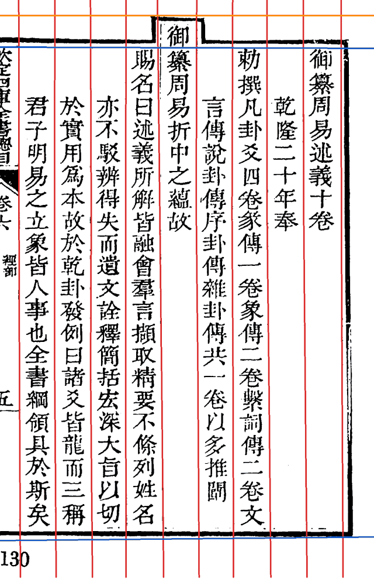
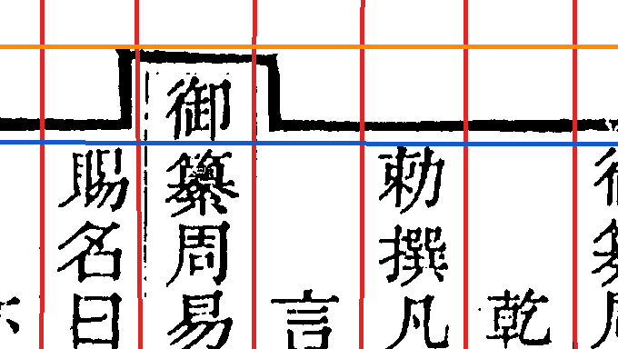
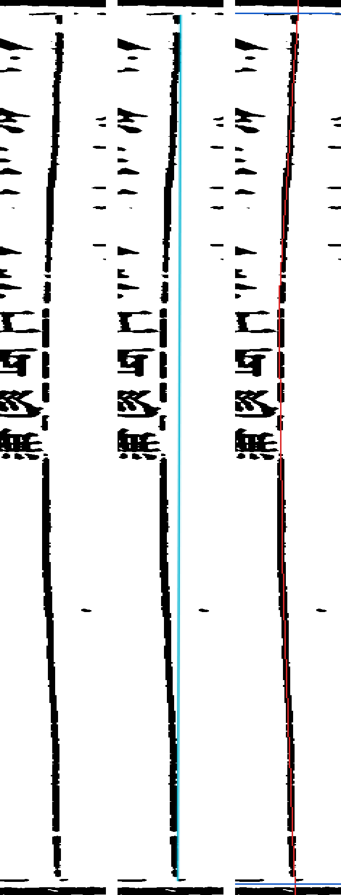
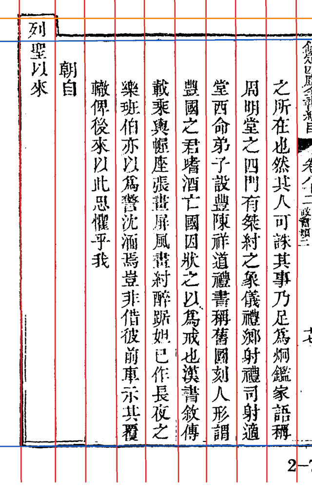
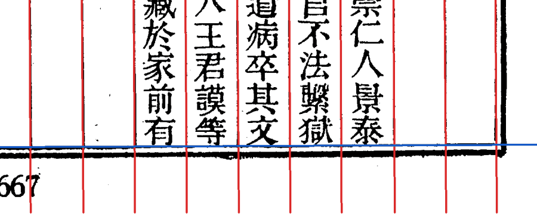
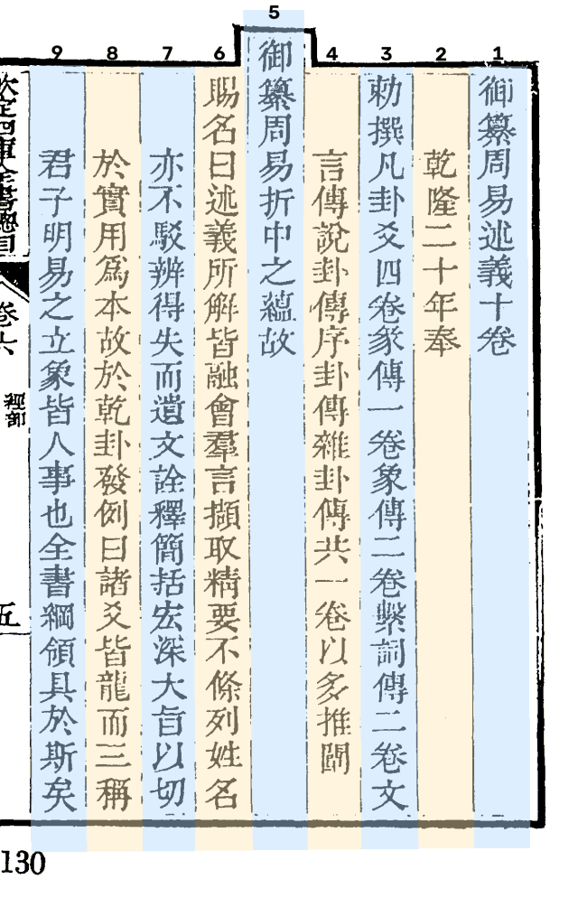
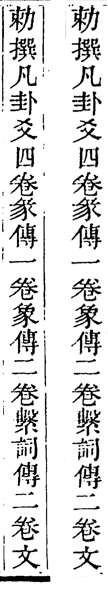

# 1 版面（`layout`）

原九步的 版面：把一张原图变成「版框、界行、印章、拉直的一列一列」。四个小步：1a 页面预检、1b 版框界行、1c 印章（见 [印章](印章)）、1d 单列拉直。页型（正文、职名、表格、插图）也在这一步判，见 [页型、表格页与插图](页型表格页与插图)。

命令：`guji pipeline <管线> <册> --from layout --to layout -w <工作区>`。步骤、产物、参数的完整表在仓里 [doc/1-版面](https://github.com/open-guji/open-guji-cv/tree/dev/doc/1-版面)。

## 1a 页面预检（`page_survey`、`invert_detect`）

- `page_survey`：量每页原图尺寸，和本册中位数比，标出异常页（对开没拆、裁掉半页、扫进了别的东西）。
- `invert_detect`：找界行被扫成白底黑带的「反色带」，只送人看，不自动修；人点头后进预清理（`guji preclean`），管线后面各步读预清理过的图。

殿本这几册都没有命中，所以这里没有放图。

## 1b 版框界行（`border_detect`）

*殿本 vol04 第 9 页。红线：界行和左右版框；蓝线：上下版框；橙线：抬头框的上沿。*

### 做什么

从**原图**上直接找出版框（上下左右）和界行（列与列之间的竖线），每页得到一组线，后面每一列就夹在相邻两条竖线中间。不先做去斜、裁边：找线的算法本来就在原图上同时搜位置和角度，预处理反而会把线挪位。

- 竖线不一定直：殿本的界行常常中段弯，所以每条界行拟成**一段直线或三段折线**（产物里 `slope`、`k2`、`k3`）。
- 顶格抬头（「御纂」「欽定」这类字比正文高出一截）有自己的小框，记在 `head_raise`。
- 外框是单边还是双边、有没有被裁掉，记在 `top_frame_kind`／`bottom_frame_kind`。

### 抬头框

*第 5 列「御纂周易折中」比正文高出一格，版框在这里往上凸出一个小框。蓝线是正文的上框，橙线是抬头框的上沿。*

### 折线：中段弯的界行

刻版、印刷、纸张收缩都会让界行不直。直线只能对上两头，中段就偏到字上，后面拉直列、切格都跟着歪。这时界行改拟成**三段折线**：两个折点 `y1`、`y2` 把线分成三段，各有斜率（`slope`、`k2`、`k3`）。

*vol04 第 146 页第 5 条界行（右起），只截了界行左右各 30 像素，**横向放大 3 倍**好看出弯。左：原图，界行中段向左鼓出约 12 像素。中：青线把上下两端直接连起来，中段离开了界行。右：红线是 1b 拟出的三段折线，从头到尾贴着界行走。在这条线上量，折线压着墨的点占 92%，直线只有 19%。*

怎么定（`seg/polyline.py`）：

1. 沿每条界行逐行量墨偏离直线多少，得出这一页的弯度。弯度中位 ≥ 7 像素，或任一条线 ≥ 24 像素，整页才改拟折线；其余的页仍用直线。
2. 折点的高度固定在版框内 1/3、2/3 处（这一页是第 685、1280 行），每个折点只在直线估计左右 40 像素内找位置，跳不到隔壁界行去。
3. 两道保险：相邻两条折线之间的列宽沿高度变化超过 25% 就退回直线；折线贴线的得分不比直线高，也退回直线。

**拟错的时候**：界行很淡、字的竖笔又正好压在线上时，折线偶尔会被字「吸」过去，中段斜穿过正文（例如 vol04 第 65 页，2026-11 已交给切分修）。这种页 2a 会把一格切在两个字中间，最后在 4b 落人审，不会被自动放行。

### 难例

**界行淡到几乎看不见。** vol40 第 34 页（新图源）界行很淡，中段还有字的竖笔压着，旧版把折点吸到了字上。现在照样能把九条界行都找准：

**下框被末行字吸走。** vol84 第 89 页每列末字底边连成一排，像一条横线；旧版（border_detect 1.12 及以前）把它当成下框，整页下框上移一格，每列末字被切掉。1.13 起改在更宽的窗里量峰，下框回到真正的版框上（蓝线）：

vol20–99 共 13,320 页重筛，54 页下框下移约一格，逐页看图都改对了。

### 出口闸 `border_detect_gate`

跑完后判这一页能不能往下走：页型（正文、职名、目录、空栏、封面、牌记、表格页……）、列数对不对、界行有没有跑飞（`vline_wander`）、外框缺不缺（`outer_frame_missing`）。封面、书签、牌记、表格页跳过，后面各步不再处理。页型见 [页型、表格页与插图](页型表格页与插图)。

### 代码与文档

- 殿本这套的实现在 `open_guji_cv/impl/keben/border.py`；找线的共用原语在 `seg/lines.py`（投影、半高宽找峰、位置＋角度联合搜索）、`seg/polyline.py`（折线拟合）、`seg/grid.py`（网格模式：列数已知、列距均匀时逐槽验线，北行古本整书用它）。
- 设计与失败案例：[doc/经验/切分四步-研发记录.md](https://github.com/open-guji/open-guji-cv/blob/dev/doc/经验/切分四步-研发记录.md) Step 1 一节、[doc/design/peak_line_search.md](https://github.com/open-guji/open-guji-cv/blob/dev/doc/design/peak_line_search.md)。
- 看任一页的叠图：`guji pipeline product overlay <册> border_detect --page N --out x.png -w <工作区>`。

## 1d 单列拉直（`column_warp`）

*vol04 第 9 页，相邻两条界行之间就是一列，交替着色。列号从右往左数，和读的顺序一致；第 5 列是抬头列，比别的列高出一截。*

### 做什么

按 1b 找到的界行，把每一列从原图上「抠」出来：两边的界行可能是斜的、弯的，这一步把这一条四边形（折线界行时是分段的）射影变换成一条笔直的竖条，同时清掉界行残墨、版框和噪点。之后的 2a、2b 都在这张**列图**上做，坐标再按 warp 参数换算回原图。

*vol04 第 9 页第 3 列。左：原图上沿界行裁出来的一条（两边还有界行和残墨）。右：拉直后的列图，界行清掉了。*

### 列图存哪里

列图不进产物包，存在本机缓存 `cache/`，缺了按产物现场重建（`guji pipeline cache column <册> --page N --col C`）。产物里只记 warp 参数、每列上下界（`top_y`／`bottom_y`）、上下端有没有版框残留（`triage`）。

### 出口闸 `column_gate`

挂在这一步上：每列判 ok／疑似／拒，拒的列（比如列宽和本页周期差太多、两列粘在一起）不进 2a，交人看。闸的判据和分档见 [doc/经验/切分四步-研发记录.md](https://github.com/open-guji/open-guji-cv/blob/dev/doc/经验/切分四步-研发记录.md) Step 2 一节。

代码：`seg/warp.py`（单列射影、列窗口）、`seg/profile.py`（去噪、投影）、殿本的界行残墨剥法在 `impl/keben/column.py`、`column_triage.py`。

> **v0.8 起缺省**：`column_warp.det_warp` 缺省开、`row_segment.cut_judge` 缺省 `unet_f64`（切分开关收敛，2026-11-13 定）。殿本、史記、全唐文早已显式写，结果不变；没写的老书重跑时会按新缺省走。

