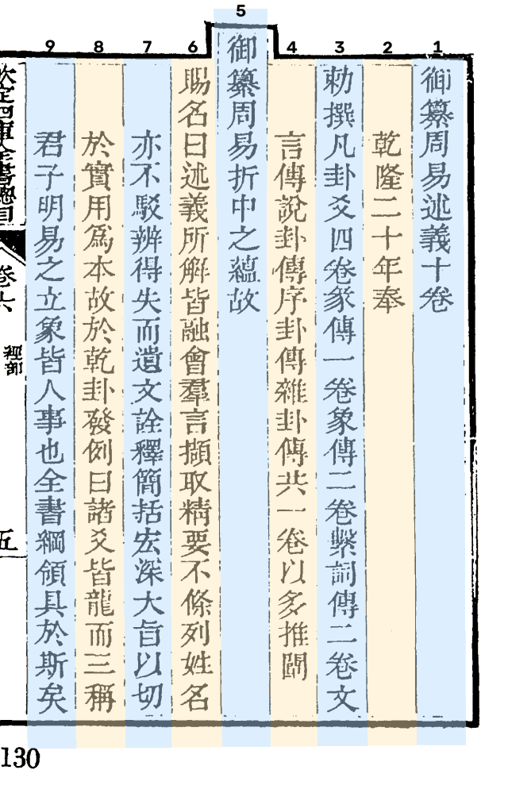
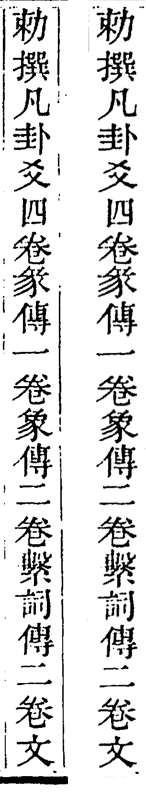
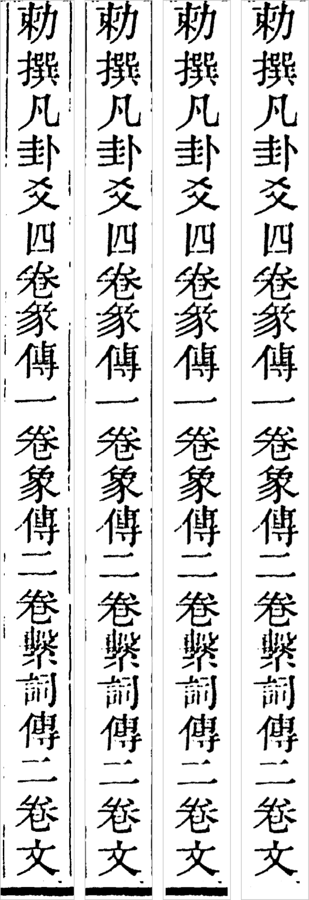
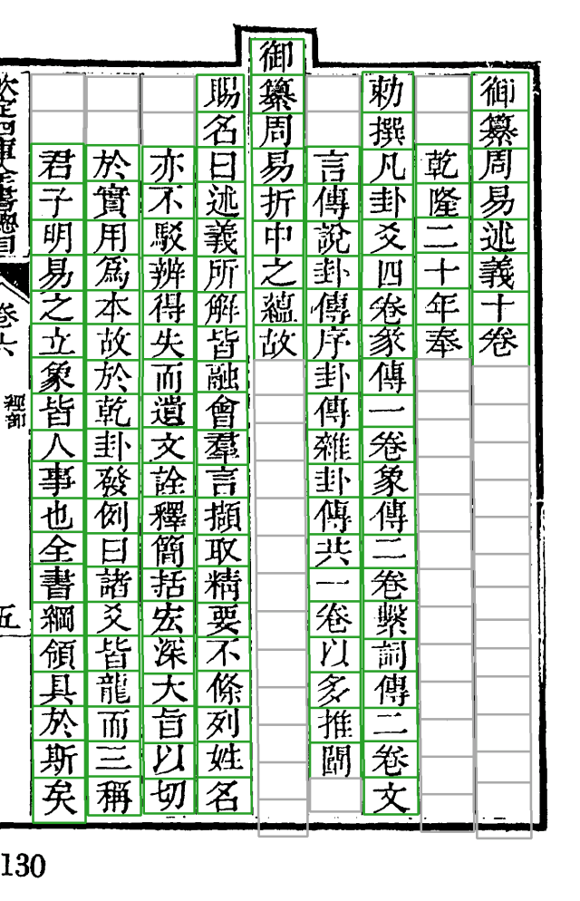
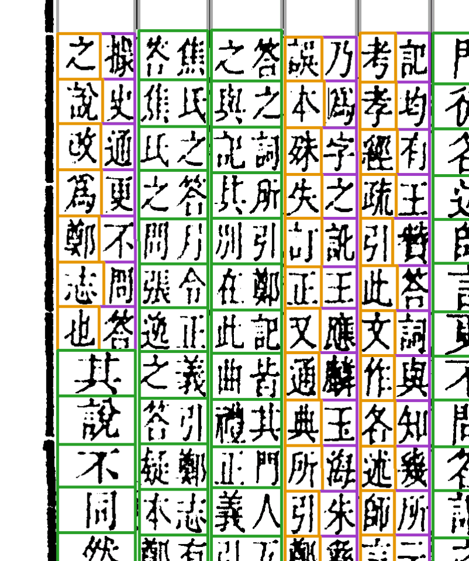
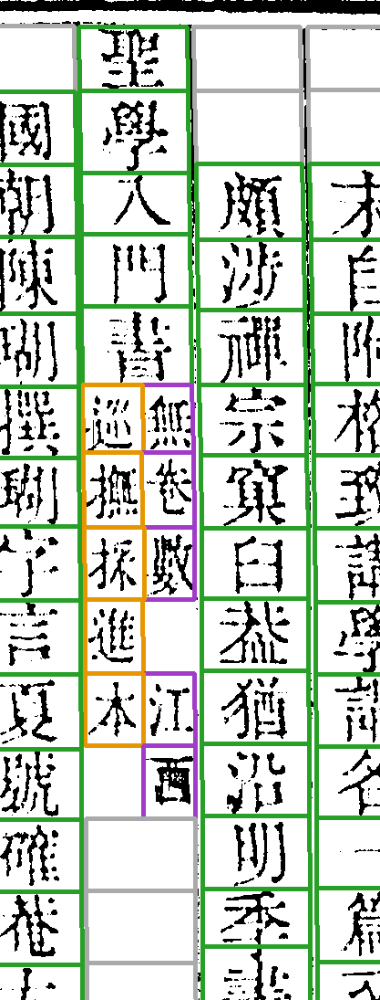
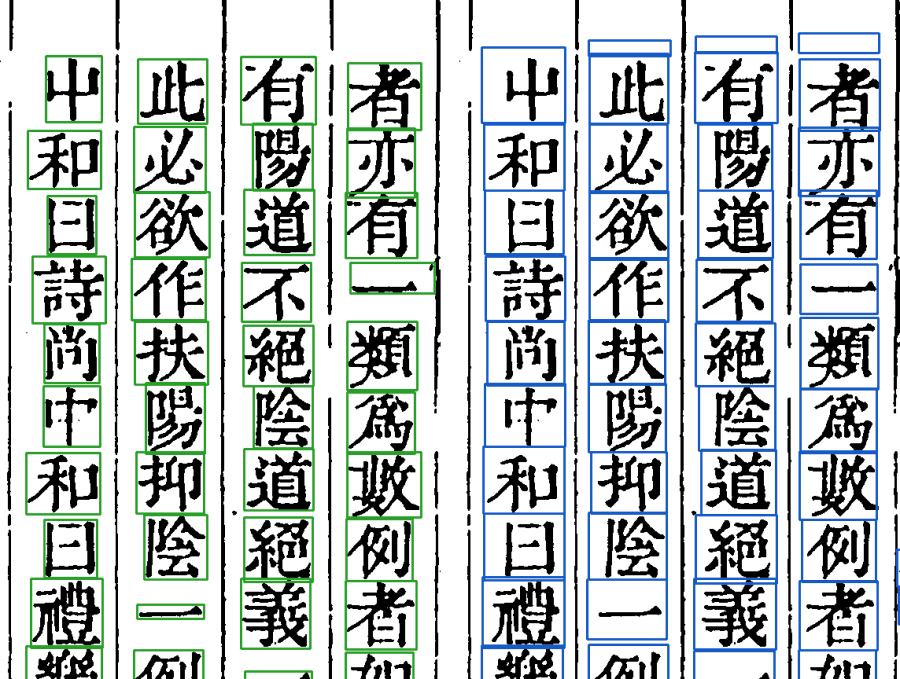
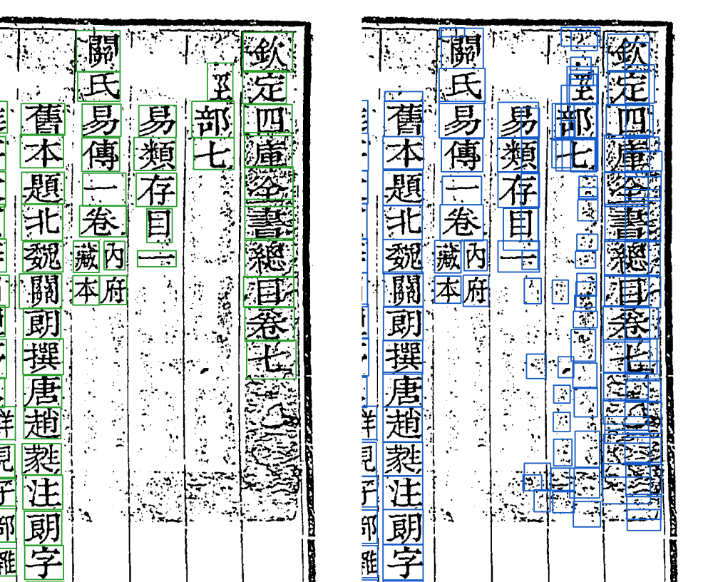
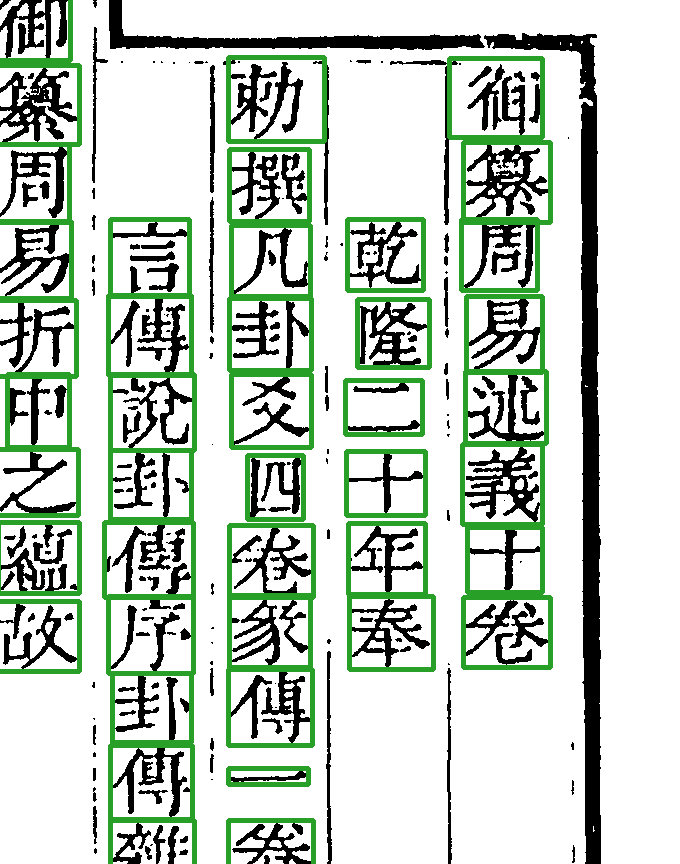

# 2 切字（`cut`）

把每一列拉直、去掉界行和版框、切成一格一格（字、空格、夹注……），再把每格收成紧贴墨迹的字框，交给 [3 识字](3-识字)。单列拉直（原属 1 版面）2026-11-22 起归这一步。

切字分五个小步（2026-11-25 用户定，同日拆成五个独立 Step，cv #1869、#1872）。用户定的次序是**先处理字和框的连接处，再切字与字**：

| 小步 | Step id（刻本链） | 输入 | 产出 | 只做什么 |
|---|---|---|---|---|
| [2a 拉直](#2a-拉直column_warp) | `column_warp` | 原图、`borders` | 列窗 `column_windows`、去噪列图 `column_raw` | 只管几何，不判墨、不找线 |
| [2b 字带左右边](#2b-字带左右边column_band) | `column_band` | `column_raw` | 文字带 `column_bands`、抹了界行的列图 | 只看列图左右两端 |
| [2c 列端字](#2c-列端字column_end) | `column_end` | 2b 的列图、2a 的列窗、`borders` | 列端档位 `column_ends`、最终列图 `column_image` | 只看首尾紧挨版框的地方 |
| [列几何](#列几何column_geometry) | `column_geometry` | 2a–2c 产物、页型闸 | 每列文字带、格线范围、页级字距；结构性不切的列 | 只算量，不判质量 |
| [2d 字间切分](#2d-字间切分row_segment) | `row_segment` | `column_image`、文字带、列几何、版式先验、人定切分 | `cells`：每格上下界、类型、读序 | 只在字带内切缝 |
| [2e 字框压缩](#2e-字框压缩cell_shrink) | `cell_shrink` | `cells`、`column_image` | `char_index`（紧框＋flags）、字块图 `char_patch` | 只改框，不改 2d 的格线 |
| [出口闸](#出口闸cut_gate) | `cut_gate`（挂在 2e） | 2a–2e 全部产物 | 裁决清单 | 只出裁决，不挡中间步 |

现代排印链是 `column_crop`（2a）→ `row_segment_runs`（2d）→ `cell_shrink`，出口闸 `column_gate`；自由版式链是 `column_trace`（2a，可选 `line_ocr`）→ `cell_cut`（2d）。2b、2c、列几何只在刻本链。

命令：`guji-cv pipeline <管线> <册> --from cut --to cut -w <工作区>`；只跑一个小步 `guji-cv step column_end <册> -w <工作区>`。每步的参数、缺省值在仓里 [doc/2-切字](https://github.com/open-guji/open-guji-cv/tree/dev/doc/2-切字)，每小步的边界说明在 [五小步.md](https://github.com/open-guji/open-guji-cv/blob/dev/doc/2-切字/五小步.md)。

坐标：「页」坐标是原图（右上角原点、y 向下）；「列图」是拉直后的竖直矩形（左上角原点），2b–2e 都在列图上做，再按 2a 的变换换算回原图。列图、字块图不进产物包，存在本机 `cache/`，缺了按产物现场重建（`guji pipeline cache column <册> --page N --col C`）。

## 2a 拉直（`column_warp`）



*vol04 第 9 页，相邻两条界行之间就是一列，交替着色。列号从右往左数，和读的顺序一致；第 5 列是抬头列，比别的列高出一截。*

### 做什么

按 1 版面找到的界行，把每一列从原图上「抠」出来：两边的界行可能是斜的、弯的，这一步把这一条四边形射影变换成一条笔直的竖条（折线界行按折点分带，每带一个矩阵），顺手去掉孤立的小墨点。2a 只管几何：界行残墨留给 2b，列端版框留给 2c。



*vol04 第 9 页第 3 列。左：原图上沿界行裁出来的一条（两边还有界行和残墨）。右：走完 2a–2c 的列图，界行和列端残墨清掉了。*

代码：`seg/warp.py`（`page_column_windows`、`warp_column`）、`seg/profile.denoise_column`。

> **v0.8 起缺省**：`column_warp.det_warp` 缺省开、`row_segment.cut_judge` 缺省 `unet_f64`（切分开关收敛，2026-11-13 定）。殿本、史記、全唐文早已显式写，结果不变；没写的老书重跑时会按新缺省走。

## 2b 字带左右边（`column_band`）



*vol04 第 9 页第 3 列走过 2a→2b→2c，从左到右：原图上的一条；2a 拉直后的 `column_raw`（左边界行还在）；2b 抹掉左右界行后的 `column_banded`（列尾版框还在）；2c 剥掉列端版框后的 `column_image`，后面各步都用它。*

### 做什么

在 2a 的列图上做竖直墨量投影，找出文字带的左右两端，带外的界行抹白（**抹白、不裁**，列图尺寸和坐标不变）。

- 旧算法：按 240 行一段横条各找一次文字带、抹界行（`impl/keben/column.py` 的 `column_text_band`、`strip_column_rules`）。写本可开 `tight_rule_band`，全唐文开 `inner_bar_span`。
- 新切点 `side_cut`（2026-11-25 起缺省开，`seg/side_cut.py`）：再整列投影一次，只在上下版框之间取、各让 60 行；认出框线后在框线内侧 15% 列宽里取第一个够低处，往里缩 2px，切点外整列抹白。
- **2d 仍用旧算法给的文字带宽度**：字带窄 1～3px，史記的切线就大片挪动，所以新切点只用来抹白，不改 `column_bands` 的数值。
- 认不出的：点线、双线里的细内线（墨占比 < 0.3），靠旧算法那一遍抹。

金标：open-guji-dataset `char-segmentation/side-rule`（左右缘竖线剥没剥掉、字的竖笔有没有误伤）。

## 2c 列端字（`column_end`）

### 做什么

每列首、尾紧挨着上下版框的地方，判这一端是只有框线还是框线连着字，剥掉框线、按内框线位置切（列端曲线切边）。它是切字里**唯一同时用上下版框坐标和字墨**的一步，排在字间切分之前。

- 每端判一个档位（a～e，带层数后缀如 `a2`），记在 `column_ends`；双线版框的第二道、内框线一起处理。算法从原 `column_warp` 后半（`column_border_trim`）原样搬来。
- e 档要看边距证据，所以读的是 2a 抹界行**之前**的列图 `column_raw`。
- 进指纹的册配置：`frame_layers`（版框几道线）、`outer_gap`。
- 输出的 `column_image` 就是后面各步用的最终列图（名字沿用旧的，下游照读）。

列端问题还没有全部收进这一步：`row_segment` 里还有列端判空（`frame_only_edge_cells`），`cell_shrink` 里还有剥框线（`strip_frame_line`，见 [2e](#剥框线)）。列端格在识字、定字里出问题时，三处都要看。

金标：`char-segmentation/cut-frame`（史記、全唐文列首列尾字，CV2 11-26 起）、`frame-end-crop`（殿本 451 格）、`column-end-class`。

## 列几何（`column_geometry`）

2c 之后、2d 之前，算每列的文字带、格线范围（`top_slack`、抬头提示）和整页纵向字距（`period`，可用书级 `period_prior` 兜底）。**只算量，不判质量**；只有版式上的事实才记成「这列不切」：页型闸判跳过的页、`line_index` 判出的非正文列位、册配置点名的表格列（`table_cols`）、整页字距估不出来。原来混在 `column_gate` 里的质量判据都挪到最后的出口闸。

## 2d 字间切分（`row_segment`）



*vol04 第 9 页的字格。绿框：字；灰框：空格（列头、列尾没字的格位也要占格，后面对位要用）。*

### 做什么

在 2c 交出的列图上，只在文字带里沿竖直方向找字缝，把一列切成一格一格，每格标类型（字 `char`、空 `blank`、标点 `punct`），排好读序。殿本是**格位制**的：每列有固定的格数（正文 21 格），先按本页的行距建一张格位表，再在每个格位里找真正的切点。

- 切点不是简单的横线：字与字常常笔画相接，所以沿着「最省墨」的缝走（`seg/seam.py`），拿不准的切点交 U-Net 判官打分（`seg/cut_select.py`）。
- 职名页这种字距不定的列，参照整理本这一列的字数重切（`roster_ref`，史記职名页用得最多）。

### 夹注（双行小字）

正文里的小注是一格位里并排两行小字。切的时候整格先认出来，再左右劈开，读序是**先右行（a）后左行（b）**：



*vol16 第 6 页。紫框是夹注的右行（`sub=a`），橙框是左行（`sub=b`），绿框是正文大字。*

### 难例：双行小注长短不齐



*vol46 第 106 页第 4 列：「聖學入門書」五个大字之后接双行小注「巡撫採進本／無卷數　江西」，两行字数不一样多，左行比右行短，空出的位置不切格。*

### 和 YOLO 模型对照

切分有一个外部参照：[yolo-tool](https://github.com/open-guji/yolo_tool)。它用两段 YOLOv8 模型来切：先找版面框，再在框里找单字框，是另一套完全独立的做法。cv 在 `impl/keben/yolo_tool_infer.py` 里复刻了它的 ONNX 推理（只要 onnxruntime，装 `.[yolo]`），同一页图可以两边各切一遍，逐框比。

**同一页上比一比。** 下面每组图，左边绿框是我们的 2e 紧框，右边蓝框是 yolo-tool 原生输出（2026-11-03 用现行模型重跑）。



*vol04 第 96 页右上。正文字两边几乎一一对上。两处口径不同：「一」我们只框墨迹，是扁扁一条，YOLO 框整个字格；YOLO 还常在列首空白处多出一个空框。*



*vol04 第 127 页（卷首）。大印扫成黑白后是一片麻点，YOLO 在上面打出几十个碎框，我们这边有印章定位兜着，印里不出字框。*

**整册的数**（vol04 全册 217 页，同一份图）：

| | 框数 | 说明 |
|---|---:|---|
| 我们的字框，YOLO 有对应框（IoU ≥ 0.3） | 34,012（98.95%） | |
| 落在 YOLO 某个框里，但重合不到 0.3 | 283（0.8%） | 几乎全是「一」，是上面说的框口径不同，不算分歧 |
| YOLO 没有框 | 77（0.2%） | 多在列首抬头位（「國朝」的「國」、「欽定」「聖祖」），YOLO 漏掉了 |
| YOLO 的框，我们这边什么都没有 | 1,741 | 印上的麻点、列首列尾空框、版心 |
| YOLO 一个框盖住我们两格 | 7 | 3 处在 vol04 第 65 页，是我们 1b 界行拟歪、一格切在两字中间（已交给切分修），YOLO 这里是对的 |

10-19 在 vol04/05 的 100 页上做过一次逐列字数的正面对比（[doc/research/yolo_release_comparison.md](https://github.com/open-guji/open-guji-cv/blob/dev/doc/research/yolo_release_comparison.md)）。逐列字数全对率我们 96.6%，YOLO 原生 64.4%，加轻清理后 83.6%；单字框的查准、查全两边打平。两边的错几乎不重叠：我们会把横画字拦腰切开（「三」切成「一」＋「二」），YOLO 从不这样，但它会漏扁字、疏字，也会把版心当正文列。

**在什么情况下用它。** YOLO 不替代我们的切分，只在两处出场：

1. **当评测金标的一方。** 殿本 `column_counts` 评测的金标，是 daizhige 逐列本和一份「YOLO 粗切加人工修框」的成品各数一遍，两边字数一致的列才收（vol01–10 共 14,926 列）。见 [实验与评测](实验与评测#评测集open-guji-dataset)。
2. **当第二意见：YOLO 并格闸**（`row_segment.yolo_merge`，缺省关）。相邻两格落进同一个正常高的 YOLO 字框，就按少一格重切这一列，重切后对得上才采用。它只治「一个字切成两格」。

2d 一共有三个结构先验开关，按这部书的整理本是什么样子来选：

| 整理本 | 开哪个 | 殿本 |
|---|---|---|
| 逐列、带格位（每列从第几格起、哪格空、夹注在哪） | 逐列格位约束 `layout_prior` | 开着（daizhige 逐列本） |
| 逐列，但只知道每列几个字 | 逐列字数先验 `colgold_prior` | 不开 |
| 没有整理本 | YOLO 并格闸 `yolo_merge` | 不开 |

殿本有逐列格位，开了 `layout_prior` 后已经没有列可让 YOLO 并格闸动，所以殿本不开它；它是留给没有整理本的书的。在殿本测试页上，它把逐列全对率从 97.0% 提到 97.8%，没有改坏的；在北行日錄 54 页上没有误并。新书要用，先当「疑似多切 → 送人看」，在本书上量过误并再改成自动并。选法的依据见 [doc/经验/切分四步-研发记录.md](https://github.com/open-guji/open-guji-cv/blob/dev/doc/经验/切分四步-研发记录.md)「2b 结构先验：三个开关的名字与选法」（研发记录里还是旧编号，指现在的 2d）。

### 字间界线判官：给一本书打开

写本或字大小不匀的书，等距先验常把切线放进字内白缝（竹字头和下半、宀和寸之间）。`row_segment.boundary_net` 让一个小 CNN 看每条切线上下各一格，低分的线在附近换到另一条缝，格数不变。史記 42 册测试列上切线 789→808/874、原来对的列不坏（v0.7.114 起史記开）。参数、模型、能修什么修不了什么见 [doc/2-切字/字间判官.md](https://github.com/open-guji/open-guji-cv/blob/dev/doc/2-切字/字间判官.md)。

给新书打开的步骤：

1. **量基线**：在这本书的 cut-lattice 测试列（open-guji-dataset `cut-lattice/`）对应页上跑一遍切字，`python cut-lattice/score.py --pred <产物根> --books <书>` 记下线对数。
2. **先借**：册配置写 `params: {row_segment: {boundary_net: boundary_net_shiji_v1}}` 再跑一遍，`score.py --against <基线产物根>` 看翻转。线对数涨、原来对的列不坏 → 借用，跳到第 4 步。
3. **不行再训**：这本书已有 ≥10 册跑完（含人钉）的 row_segment 产物就够，不用人标：
   ```bash
   python scripts/train_boundary_net.py build --products <产物根> --raw <原图根> --vols 20,…,41 --per-vol 40 --out bn.npz
   python scripts/train_boundary_net.py train --data bn.npz --val-vol 41 --out models/boundary_net_<书>_v1/model.pt
   guji model registry && guji model upload --execute    # 再补 core/model_pack.KINDS、config/model-provenance.json，提 PR
   ```
   回第 2 步用新模型量。
4. **人看动过的列**：整册 IoU 列全对不能单独当依据（金标线位多沿用旧算法）。出动过的列给人看：
   ```bash
   guji-manager review-pages ab-items --old <基线产物>/<册> --new <开判官产物>/<册> --pages-dir <原图目录> --out-dir D --flag boundary_net
   guji-manager review-pages build col_check --items D/items.jsonl --book <页名> --out page.html
   ```
   框是新切法，红线是被换掉的旧线。收结果 `review-pages colcheck-apply`；点出来的错逐列对旧切法，只要没有「原来对、挪错了」就可以开。
5. **通知书线**：开不开、从哪册开由书线定，写进书仓 `defaults.yaml`；打开后从 row_segment 起重算。

### 怎么验

每条版式的缺省实现（`impl/<版式>/`）和每个有书级代码的书仓（`code/samples.yaml`）各有一份**样页单**，列着 10–30 页以前出过问题的页。改切分的 PR 要在样页上比改前改后，变了的页逐页看图：

```bash
python scripts/seg_samples.py affected --base origin/dev     # 这次改动牵动哪几条版式／哪几本书
python scripts/seg_samples.py submit --set affected --base origin/dev --cv <分支> --why "…"
```

细节：[doc/参考/切分代码结构.md](https://github.com/open-guji/open-guji-cv/blob/dev/doc/参考/切分代码结构.md)、行切分设计 [doc/design/row_boundaries_design.md](https://github.com/open-guji/open-guji-cv/blob/dev/doc/design/row_boundaries_design.md)、粘连与夹注 [doc/design/step3_touching_and_jiazhu.md](https://github.com/open-guji/open-guji-cv/blob/dev/doc/design/step3_touching_and_jiazhu.md)。

## 2e 字框压缩（`cell_shrink`）



*vol04 第 9 页右上：每个字收出来的紧框。整页没有带 flag 的字块，所以全是绿框；带 flag 的字块在叠图里画成红框。*

### 做什么

2d 的格是格位，四周留着空白、邻字的笔画尖、界行残墨。这一步在格里认出**属于这个字的墨**，收成紧框，裁出字块图（`char_patch`），给 [3 识字](3-识字) 去比对。2e 只改框，不改 2d 的格线，也不能丢字身的墨。


*绿框：2d 的格；红框：2e 的紧框。「御」「撰」「述」取自第 9 页，「御」右边贴着界行，紧框把界行剥在外面；「諸」取自第 2 页，带 `boundary_ink`；「三」取自第 33 页，带 `edge_blob`，字身扁，上下收得很紧。*

### flag：这个字块可能有问题

收框时顺手体检，结果记在每个字的 `flags` 里，放行时会参考。vol04 全册常见的几种：

| flag | 意思 | vol04 格数 |
|---|---|---|
| `jiazhu` | 夹注小字 | 1,027 |
| `boundary_ink` | 格边上有墨被切断（可能切到了邻字或界行） | 499 |
| `seal_region` | 在印章区里 | 189 |
| `off_center` | 字明显偏离格中心 | 133 |
| `wide_gap` | 字和格边之间空得异常 | 106 |
| `edge_blob`、`tail_junk`、`lost_patch`、`suspect_empty` | 边上墨团、尾部杂墨、字块丢失、疑似空格 | 各十来格 |

### 剥框线

列首、列尾的格常常压着版框线。毛笔画的线两边拖着毛边，旧版只看紧挨线的两行，把毛边当成字连着线，整条不剥。`cell_shrink` 1.22 起越过毛边再找白行，碰到白行就连毛边一起剥（史記 01／02 册列首格残线 98→73）。

字块不进产物包，存在本机 `cache/`，缺了按产物重建：`guji pipeline product patch <册> --page N --col C --slot S --out x.png`。

金标：`char-segmentation/instances`（单字图块四分类）、`right-cut`、`left-cut`、`cells`。

## 出口闸（`cut_gate`）

刻本链只有一道出口闸，挂在 `cell_shrink` 出口、永远最后调用：读 2a–2e 全部产物，按列数、列宽、界行残墨、印章噪点、框线残留、夹注豁免等判据出裁决（`gate_manifest`、`row_segment_gate_manifest`），**不挡中间步、不改产物**。被判有问题的列在定字里落人审，或交给人定切分（[切分覆盖](https://github.com/open-guji/open-guji-cv/blob/dev/doc/2-切字/切分覆盖.md)，15 种，有优先级）。现代链仍用 `column_gate`（挂在 `column_crop`），与此独立。

## 测试集和 benchmark

| 小步 | 主集（open-guji-dataset） | bench |
|---|---|---|
| 2a | `page-geometry` | `cut_bench.py`（ai-team，待搬进 cv） |
| 2b | `char-segmentation/side-rule`、`text-band` | 无 |
| 2c | `char-segmentation/cut-frame`、`frame-end-crop` | cut-frame 打分脚本（ai-team，待搬） |
| 2d | `cut-lattice`（165 列，四部书）、`char-segmentation/column-counts` | `cut_bench.py`：列字数全对、列全对、格 F1 |
| 2e | `char-segmentation/instances` | manager 老评测器 |

全表见 dataset [STEP_MAP.md](https://github.com/open-guji/open-guji-dataset/blob/main/STEP_MAP.md) 与仓里 [doc/bench登记表.md](https://github.com/open-guji/open-guji-cv/blob/dev/doc/bench登记表.md)。
