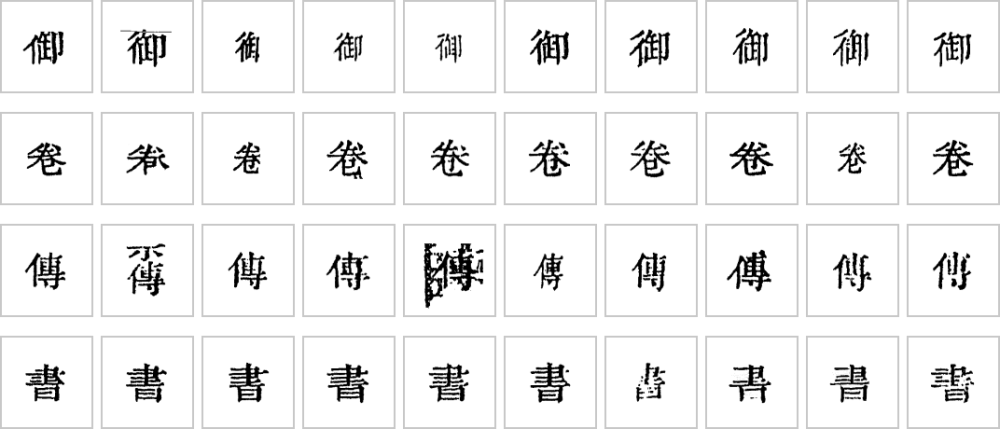

# 3 识字（`read`）

原九步的 Step5-a、5-b。整理本对位（原 5-d）不读字块图，2026-11-22 起归 [4 定字](4-定字)。命令：`guji-cv pipeline <管线> <册> --from read --to read -w <工作区>`；生僻字单查 `guji-cv read rare`。完整表在仓里 [doc/3-识字](https://github.com/open-guji/open-guji-cv/tree/dev/doc/3-识字)。

## 只看字块图取证，不定字

2c 出来的每个字块，由两路各自从图上找证据。两路**互相独立、互不投票**；把证据和整理本、上下文合起来下结论是 4 定字的事。

| 步 | 证据 | 一句话 |
|---|---|---|
| 3a `glyph_match` | 形状 | 拿字块和**本书字形库**里已经人审确认的刻例比 |
| 3b `rare_candidates` | 生僻字 | 字形库里没有的字，用字体模板＋CNN 找候选 |

（5-c OCR 一路 2026-10-18 删了：OCR 的置信度不可信，「人／入」给 0.95 照样错。）

### 3a 字形库匹配

*殿本字形库里「書」「經」「傳」「爲」的刻例，都是人审确认过、按书 ID（`96mid1ogzk`）收进库的（图里挑的是不贴邻字、没压界行的干净刻例）。同一个字刻出来大小、粗细、笔画轻重各不相同，字块要和这些刻例逐一比。*

做法：字块归一化后先用 HOG 特征找最像的几个刻例，再做弹性对齐算覆盖率 `cov`，分三档——

- **same**（`cov` ≥ 0.996 且形变小）：库里有，就是这个字；
- **unsure**（0.85 ≤ `cov` < 0.996）：进候选，交给后面判；
- **diff**（`cov` < 0.85）：库里多半没有这个字。

0.99 是实测的拐点：库判 same 的难例 27/27 全对。形近字家族（日曰、己已巳、入人八……）另有护栏，见 [字组与异体](字组与异体)。

字形库一书一个，存在中心库，按版本钉（`glyph_pin: N`），平时重跑不会因为别人刚推了人裁就变，见 [产物与数据](产物与数据)。

### 3b 生僻字候选

字形库只收见过的字。没见过的（生僻字、异体字）用三个来源融合排名：字体模板（拿几套古籍字体渲出来的字形比）、CNN 分类头、CNN 向量检索。整页批处理，checkpoint 缺了不报错，退回纯字体候选。放行时它要和整理本说的同一个字，才走 `rare_ref` 通道放行。

细节：[doc/design/Step5-7-操作一览.md](https://github.com/open-guji/open-guji-cv/blob/dev/doc/design/Step5-7-操作一览.md)、字形匹配 [doc/design/glyph_match_stack.md](https://github.com/open-guji/open-guji-cv/blob/dev/doc/design/glyph_match_stack.md)、字形库优先设计 [doc/design/glyph_db_first_design.md](https://github.com/open-guji/open-guji-cv/blob/dev/doc/design/glyph_db_first_design.md)。

> **v0.8 新增（书级开关，缺省关）**：5a 有跨书通用相似度底座 `glyph_sim_base_v1`（殿本、史記、全唐文合训）；形近字对判法按字组登记（如 `hou_shape` 判 候／𠋫、`never_group` 登记绝不并组的字对）；3b 可开「库字档」`font.charset.lib_chars`，把本书字形库人裁过、3b 自己给不出的字另开一档进候选。

