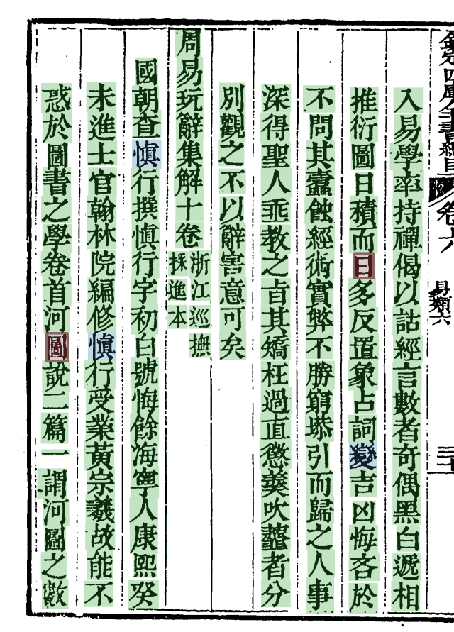
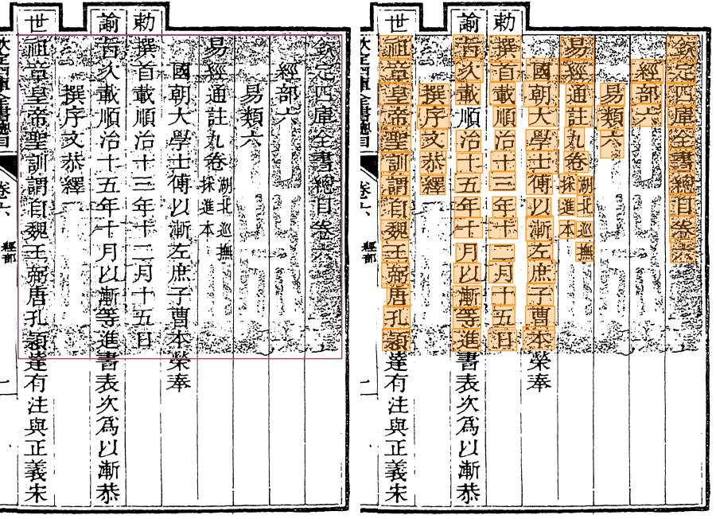
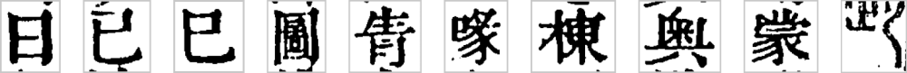

# 4 定字（`decide`）

先把参校本（整理本）对到字格上，再把第三步的字形证据、参校本和上下文合起来，给每格定字，判自动放行还是落人审。落人审之后的事（人审、入库、出文本）在 guji-manager：入库归它的第二步 `pipeline`，排版输出归第五步 `output`。

第四步分四个子步、一个收尾、一道 gate（2026-11-28 用户定），三条纪律：**子步只出证据**，不定字、不判放行；**收尾做全部判断**，人裁只在收尾里读；**gate 只检测**。

| 位置 | Step id | 做什么 | 缺省 |
|---|---|---|---|
| [4a 参照对位](#4a-参照对位align_ref) | `align_ref` | 参校本逐字对到格上，给每格「参校本说的字」 | 开 |
| [4b 上下文](#4b-上下文context_decidecontext_rank) | `context_decide`、`context_rank` | 按前后文给候选排序：门槛化给首选；填空重排给审阅卡片用 | `context_decide` 开、`context_rank` 关 |
| [4c 格况](#4c-格况cell_state) | `cell_state` | 这一格有没有要定的字：有字／空白／遮挡／印章／切坏／非字 | 关（关时收尾现算） |
| [4d 字组](#4d-字组group_decision) | `group_decision` | 已登记字组里的格：入口归属、3b 看图判法快照、字框宽高比 | 关（关时收尾现算） |
| [收尾](#收尾char_decide) | `char_decide`（旧名 `seed_admit`） | 每格最后判断：自动放行（带通道）或落人审（带送审原因） | 开 |
| [gate](#gatedecide_gate) | `decide_gate` | 检测收尾结果有没有异常，出 `fail`／`flag` 清单 | 开（只出检测产物） |

4c、4d 关着时收尾照旧现算，产物逐字节不变；打开用 `params.cell_state.enabled: true`、`params.group_decision.enabled: true`，写在书配置或册 yaml 里。收尾 `seed_admit` 改名 `char_decide` 分两版发：现在新旧名都认，产物仍写在 `seed_admit` 名下。

命令：`guji-cv pipeline <管线> <册> --from decide --to decide -w <工作区>`。形近字见 [字组与异体](字组与异体)。完整表在仓里 [doc/4-定字](https://github.com/open-guji/open-guji-cv/tree/dev/doc/4-定字)，各位置与代码的对应见 [子步.md](https://github.com/open-guji/open-guji-cv/blob/dev/doc/4-定字/子步.md)。

## 一页的结果



*vol04 第 60 页的放行结果。绿底：自动放行；蓝底：人审定过（「愼」「變」）；红框红底：落人审。这一页 159 格只落了 2 格：第 2 列的「曰」（「日」「曰」形近，上下文分不出）和第 9 列的「圖」（形近字组里几路判得不一致）。落人审的大多是这种**形近字拿不准**，不是切坏。*

## 4a 参照对位（`align_ref`）

只读第三步的产物和整理本，不看字块图：拿 3a（开了识字收尾就是收尾的候选）最有把握的字当载体，把整理本逐字对到格上。

整理本是这本书现成的电子录文（殿本用的是文淵閣本系统的《四庫全書總目》录文），版本、行款都不一定和影印本一样；语料按版本钉在册配置里（`corpus: N`）。对位有两种：

1. **锚定＋比对**：拿每格字形库最有把握的字连成串，用 8-gram 在整理本里找锚点，再逐字比对（`difflib`），得出每格 `equal`／`replace`／`insert`。
2. **坐标对位**（`align: coord`）：行款一致的书，按「第几列第几行」逐格配字；印章压住、字形认不出时也配得上。格数对不上就退回第 1 种。

整理本是**文本证据**：它在场时有一票否决权，但它自己也会错（缺字图占位、异体字录成通行字），所以不能单独放行，要和形状证据凑成双信号。

### 参校本四维：按书标一次

一部书可以有几份参校本（整理本、其他版本的录文）。每份在书配置 `references[]` 里按四个维度标一次，第四步怎么信它全由这四维推出来（2026-11-28 起是唯一入口，旧键 `quality`、`reference_trust` 等不再读）：

| 键 | 取值 | 意思 |
|---|---|---|
| `form` | `column`／`text` | 一行就是刻本一列，还是不分行的全文 |
| `punct` | `none`／`judou`／`modern` | 白文、句读、新式标点（现只记录） |
| `script` | `faithful`／`trad`／`simp` | 照录刻本字形、规范繁体（异体已归一）、简体 |
| `accuracy` | `very_high`／`high`／`mid`／`low` | 与最终定字的一致率档位：≥99.9%、≥99.5%、≥98%、其余；没量按 `low` |

```yaml
references:
  - file: qtw_kanripo_grid.txt
    form: column
    script: trad
    accuracy: high
    accuracy_evidence: "全唐文 4 册 11.1 万格一致 99.57–99.96%，待审全算错下限 99.52%"
```

序跋、职名这些参校本错得多的页段，可以在 `reference_profile` 的段上把 `accuracy` 压低（只许压低）。各书实测与推法见仓里 [参校本四维与准确度分档](https://github.com/open-guji/open-guji-cv/blob/dev/doc/design/参校本四维与准确度分档.md)。


## 4b 上下文（`context_decide`、`context_rank`）

### 门槛化定字（`context_decide`）

把字形库的候选按同一列的前文重排：本书语料的 3-gram 占 0.9，通用语料 0.1。两条铁律：

- **只在候选里挑**，不会凭上下文造出一个字形上没有的字；
- **门槛化**：语义上领先够多（margin ≥ 0.70）才动，拿不准就不动。

读序按阅读顺序，夹注先右行后左行，跨列不接。

### 填空重排（`context_rank`，缺省关）

给每个还没定的格，把候选按「图像分＋w·填空语义分」重排（左右各 24 字，只用本页），记进产物给审阅卡片排按钮、给人看「上下文觉得是哪个」。**只排序、不放行**，`context_decide` 和收尾都不读它。测试集 `char-candidates` 乙层：卡片前 3 命中从旧按钮的 80.4% 到 90.7%。

## 4c 格况（`cell_state`）

这一格有没有要定的字。六个探测器原来夹在放行步骤的各遍里「边判边改格」，现在先算成产物，收尾读它、再按放行状态决定升降：

| 探测器 | 看什么 |
|---|---|
| `occluded` | 字被印章、污渍遮住 |
| `seal_blank` | 盖章的空栏 |
| `seg_box` | 字框几何不对（切坏） |
| `ink` | 印泥、墨点 |
| `jiazhu_uneven` | 夹注两行不齐 |
| `header_formula` | 表头套语 |



*殿本 vol04 第 1 页，卷首大印压在正文上。左：1c 印章找到的范围（紫红框）。右：4c 把印章底下的 88 格判成 `occluded`（橙），收尾据此不让它们自动放行；没压到的 21 格是 `char`，照常定字。v0.9.16 dev 版开 `cell_state` 跑出。*

和 3d 的分工：3d 只看字块图给原始分；4c 还读切分、印章、参校本对位，给的是「这一格是什么状况」。测试集还没有（待建 `decide-bench/cell-state`）。

## 4d 字组（`group_decision`）

已登记字组（形近、异体、码位归一）里的格，出判断要用的**原料**，不定字：

- 字组入口归属：这格算进哪个组，是单独进组还是连带进组；
- 3b 看图判法的结论快照（第四步读 3b，不再自己算）；
- 字框宽高（日曰这类靠扁窄分的组用）；
- 按组的处理方式定稿（登记表缺省＋书级 `params.group_decision.handling` 覆盖）。

补放、改字、降审、文意裁定、看图裁定缓存都在收尾。见 [字组与异体](字组与异体)。


## 收尾（`char_decide`）

读 4a–4d 全部证据、人裁与排除名单、书级通道表，每格给出两种结论之一：**自动放行**（定了字，随后进字形库）或**落人审**。四条原则：

1. 参校本在场时，它有一票否决权（信到什么程度由四维定）；
2. OCR 只供候选，置信度不参与任何自动判断；
3. 字形库匹配按 `cov` 分档采信，0.99 是拐点；
4. 凑双信号要挑**误差独立**的两路：文本×形状可以，OCR×形状不行（错例里两者常同错）。

满足哪种组合就走哪条**通道**。vol04（cv 0.5.26 的 main 包）34,471 格的去向：

| 通道 | 格数 | 什么情况 |
|---|---:|---|
| `match_ref` | 32,211 | 字形库和整理本说的是同一个字 |
| `human` | 622 | 以前人审定过（裁定事件回流） |
| `rare_ref` | 578 | 生僻字候选和整理本一致 |
| `context` | 183 | 上下文过了门槛，且与其它证据不冲突 |
| `match_replace` | 171 | 这格在整理本对位里属于改字段（replace），但字形库首位与整理本同字、cov 够高 |
| `seal` | 158 | 印章遮挡格，按印章区规则 |
| `witness3` | 158 | 待审格里，其它版本录文（证人）、整理本、坐标对位三方说同一个字 |
| `group_flow` | 83 | 形近字组的专门流程判定 |
| `match_solo` | 77 | 无整理本参照，字形库 cov ≥ 0.99 |
| 其它（`coord_fallback` `note_lexicon` `split_ref` `ref_lib` `iron` …） | 150 | 各种补放与规则 |
| **落人审** | **80**（0.23%） | |

同一时期殿本其它几册的落审率在 0.23%–0.38% 之间。

### 落人审的格长什么样



*vol04 各页落人审的格（2e 字块），从左到右：「曰」「己」「巳」（日曰、己已巳形近字组，组内流程弃权）、「圖」（组内几路不一致）、「眚」「彖」（库里刻例太少，cov 不到 0.99，上下文也分不出）、「揀」「奧」（整理本这里是改字段，和字形对不齐）、「䝉」（生僻字，整理本守卫不让上下文改）、最后一格是少见的切分问题：格只切到字的一角，形状像乱码（`ctx_garble_shape`），不让上下文硬改。vol04 全册落审 80 格，其中 52 格是形近字组。*

每格都记着为什么放不了：送审原因 `pending_reason`（统一的枚举，取值见仓里 [待审原因PendingReason.md](https://github.com/open-guji/open-guji-cv/blob/dev/doc/design/待审原因PendingReason.md)，收尾直接写）和更细的疑问码 `doubts`，如：

| 原因 | 意思 |
|---|---|
| 库里没有这个字（`diff`） | 字形对不上库里任何刻例 |
| 上下文 margin 不足 | 候选之间语义上分不出高下 |
| `ctx_garble_shape` | 上下文想改，但字块形状像乱码，不让改 |
| `replace_align`、`context_vs_ref` | 整理本和上下文说的不是同一个字 |
| `near_form`、`group_flow_abstain` | 形近字组，组内流程弃权 |

落审的格出成待审单，由人在控制台或网站上定字；人裁记成事件，回流后这格走 `human` 通道（审单、投票、回流在 guji-manager 一侧）。人裁、文意裁定都挂在字格永久编号 u 上，重切后格号变了也跟得上：见 [字格永久编号 u（cv 侧）](字格永久编号u)。

### 护栏：拦住不该放的

放行前还有一串护栏，把本来会放的格拦回人审，如：遮挡／印章、上下文乱码与空白与窄格、异体间接路径（`variant_indirect_guard`）、影子模型否决（`shadow_veto`）、己已巳永远人审（`always_review`）。

开关和通道的完整清单：[doc/design/Step5-7-操作一览.md](https://github.com/open-guji/open-guji-cv/blob/dev/doc/design/Step5-7-操作一览.md)、[doc/开关登记表.md](https://github.com/open-guji/open-guji-cv/blob/dev/doc/开关登记表.md)。

## gate（`decide_gate`）

挂在收尾出口、永远最后跑，读第四步全部产物，每页出一份检测清单。**只检测、不判断**：不改任何格、不挡别的步骤、没有任何步骤读它（所以不进任何指纹）。检测项分两级：

| 级别 | 例子 |
|---|---|
| `fail` | 某列报错没出结果（`step_error`）；连续 3 个以上放行字恰好等于参校本错开一位的字（`ref_shift`）；放行字在候选、参校本、上下文、证据、人裁里哪儿都没出现过（`char_not_in_evidence`）；放行格在切分里是空白（`admit_blank_cell`） |
| `flag` | 参校本对位缺席或没锚上却有放行；整列坐标对位退回；改用备选切法的列；放行了罕用码位而参校本是它的常用异体；有人裁没绑到格或和放行字不同 |

殿本 vol04 第 1、2、9、60 页用 dev 版跑过，四页都没有检测项（清单为空），所以这里不放截图；出图脚本留了 `gate` 图层（`fail` 红、`flag` 黄），等有例页再补。

manager 体检汇总 `fail`，decide-bench 报告里也带。检测项全表见仓里 [decide_gate.md](https://github.com/open-guji/open-guji-cv/blob/dev/doc/4-定字/decide_gate.md)。

## 测试集和 benchmark

| 位置 | 主集（open-guji-dataset） | 指标、护栏 |
|---|---|---|
| 4a | `decide-bench` 子步指标；`char-segmentation/align-anchor`、`align-gate`、`ref-mismatch` | 错位格数；好列不许被换坏 |
| 4b | `context-correction`、`confusable-context`、`char-candidates` | 前 1／前 3、伤害率 |
| 4c | 待建 | 漏字（有字判无字）必须为 0 |
| 4d | `char-groups`、字组定向金标 | 判定格错字 |
| 收尾 | `decide-bench` small（9,422 格）／large（11,355 格）、`rough-bench` | 放行率；**放错字必须为 0** |
| gate | 事故回归例（ai-team `gate_bench.py`） | 检出率、误报率 |

decide-bench 只跑第四步、关掉人裁，覆盖殿本、史記、全唐文、脉经。全表见 dataset [STEP_MAP.md](https://github.com/open-guji/open-guji-dataset/blob/main/STEP_MAP.md) 与仓里 [doc/bench登记表.md](https://github.com/open-guji/open-guji-cv/blob/dev/doc/bench登记表.md)。
