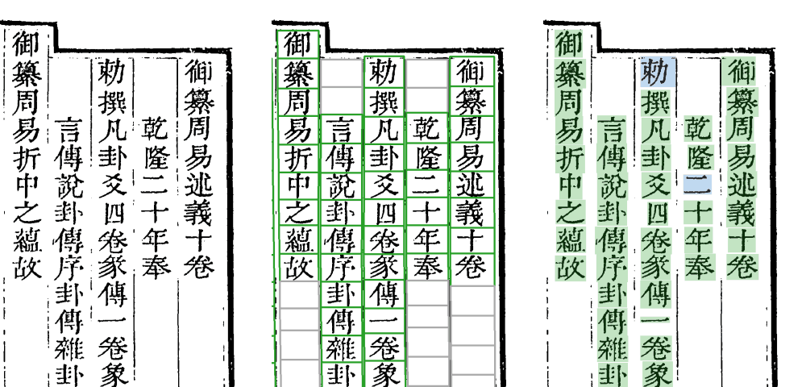

# open-guji-cv Wiki

> **本 Wiki 对应 v0.9**（以 v0.9.0 为基线，2026-11-23 改；按四大步重排；v0.8 版 2026-11-21、v0.7 版 2026-11-10 写）。每升一次 MINOR 版本整体重改一遍，规矩见文末与 [版本历史与 Wiki 维护](版本历史与Wiki维护)。

open-guji-cv 是开源古籍的**图像引擎**：把一张古籍影印页切成一列一列、一格一格，给每一格定出是哪个字，定不了的交给人审。它分四大步：**[1 版面](1-版面) → [2 切字](2-切字) → [3 识字](3-识字) → [4 定字](4-定字)**，整个属于 guji-manager 五步里的第二步 `pipeline`。眼下的主力书是[殿本《四庫全書總目》](殿本四庫總目)，另有史記文淵閣本、全唐文在做（见[各书一览](各书一览)）。



*殿本《四庫全書總目》vol04 第 9 页右半。左：原图。中：2a 切出的字格（绿色是字，灰色是空格）。右：4b 的放行结果，绿底是自动放行，蓝底是人审定过的字。整册 34,471 格，自动放行之外只剩 80 格要人看（0.23%）。*

## 它管什么、不管什么

| open-guji-cv（本仓） | guji-manager |
|---|---|
| 产物的**每个字节怎么算出来**：版面、切字、识字、定字四大步，产物格式、指纹与过期 | 一切**对外交互**，分五步：`start` 新书启动、`pipeline` 自动化流程（含跑 cv）、`text` 文意与知识提取、`feedback` 反馈迭代、`output` 排版输出 |
| `guji-cv pipeline <管线> <册>`、`guji-cv step`、`guji-cv status`，以及各大步的工具命令 | `guji start …`、`guji pipeline job …`、`guji output export`…（原第 8 步入库、第 9 步排版输出都在这边） |

人审、任务库、中心库怎么操作，看 guji-manager 的 Wiki。这里讲图像这一侧。

## 按要干什么找

| 我想… | 看 |
|---|---|
| 知道一张图要经过哪几步 | [管线全景](管线全景) |
| 看懂切分各步的叠图 | [1 版面](1-版面)（版框界行、单列拉直）→ [2 切字](2-切字)（逐字切分、字框收缩） |
| 知道一个字怎么被认出来、为什么落了人审 | [3 识字](3-识字)、[4 定字](4-定字)、[字组与异体](字组与异体) |
| 处理印章、表格页、插图 | [印章](印章)、[页型、表格页与插图](页型表格页与插图) |
| 看殿本四庫總目一部书的全貌 | [殿本四庫總目](殿本四庫總目) |
| 接一部新书、看史記和全唐文 | [各书一览](各书一览) |
| 找产物存在哪、版本怎么钉 | [产物与数据](产物与数据) |
| 做 A/B 实验、看评测 | [实验与评测](实验与评测) |

## 五分钟上手

```bash
git clone https://github.com/open-guji/open-guji-cv && cd open-guji-cv
uv venv .venv --python 3.12 && uv pip install -e ".[torch,dev,datastore]"
python -c "import torch, scipy, cv2"          # 缺件不报错只会悄悄降级，装完先自检
# 再装 guji-manager（取原图、中心库要用）：uv pip install -e ../guji-manager

guji db pull -w <工作区>                        # 册配置、字形库、语料从中心库拉
guji start source pull vol04 -w <工作区>       # 原图
guji-cv pipeline keben_body_v2 vol04 --pages 9 -w <工作区>                     # 四大步全跑
guji-cv pipeline keben_body_v2 vol04 --pages 9 --from layout --to cut -w <工作区> # 只跑版面、切字
guji pipeline product overlay vol04 row_segment --page 9 --out p9.png -w <工作区>
```

从新书启动到出版本的完整流程见 [guji-manager 的 Wiki](https://github.com/open-guji/guji-manager/wiki)。

## Wiki 维护规矩

1. **平时不追着改。** PATCH 版（vX.Y.Z 的 Z 变）不要求动 Wiki。Wiki 只讲「看图懂系统」，命令和参数细节链到仓里 `doc/`，所以多数 PATCH 不会让它过时。
2. **每升一次 MINOR（Y 变），必须整体重改一遍 Wiki：**
   - 列出上一个 MINOR 以来的全部 PATCH（`CHANGELOG.md` 各节，加 `git log vX.(Y-1).0..vX.Y.0`），归纳动了哪些 Step、加了哪些功能；
   - 逐页对照，过时的改，新功能补页；
   - 截图重出：取新版的 main 产物包，跑 `python wiki/tools/make_shots.py`（见 [wiki/tools/](https://github.com/open-guji/open-guji-cv/tree/dev/wiki/tools)）；
   - 在 [版本历史与 Wiki 维护](版本历史与Wiki维护) 记一段，首页顶上的版本号改成新的。
3. **MINOR 发版清单里有这一项**（`doc/版本号规矩.md` 第八节）：发版 PR 里写一行「Wiki 已按 vX.Y 重改」才算发完。
4. Wiki 的源文件在仓里 `wiki/` 目录，走 PR 改；合进 main 后由 workflow 同步到这里。**不要直接在网页上改 Wiki**，下次同步会被盖掉。
5. 公开仓：不写令牌、密码、内部地址。
