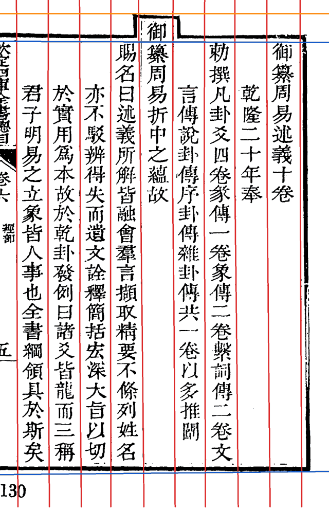
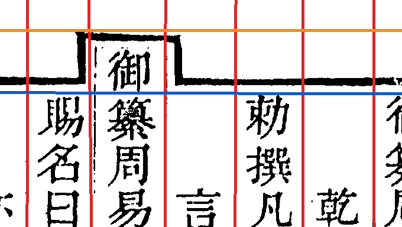
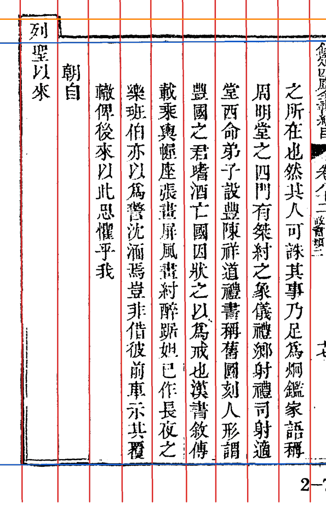
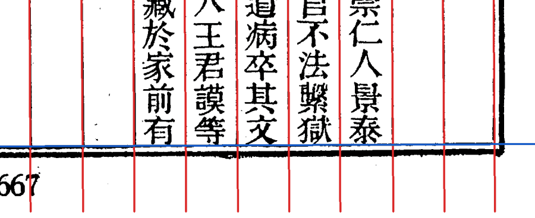

# Step1 边框与界行（`border_detect`）

*殿本 vol04 第 9 页。红线：界行和左右版框；蓝线：上下版框；橙线：抬头框的上沿。*

## 做什么

从**原图**上直接找出版框（上下左右）和界行（列与列之间的竖线），每页得到一组线，后面每一列就夹在相邻两条竖线中间。不先做去斜、裁边：找线的算法本来就在原图上同时搜位置和角度，预处理反而会把线挪位。

- 竖线不一定直：殿本的界行常常中段弯，所以每条界行拟成**一段直线或三段折线**（产物里 `slope`、`k2`、`k3`）。
- 顶格抬头（「御纂」「欽定」这类字比正文高出一截）有自己的小框，记在 `head_raise`。
- 外框是单边还是双边、有没有被裁掉，记在 `top_frame_kind`／`bottom_frame_kind`。

## 抬头框

*第 5 列「御纂周易折中」比正文高出一格，版框在这里往上凸出一个小框。蓝线是正文的上框，橙线是抬头框的上沿。*

## 难例

**界行淡到几乎看不见。** vol40 第 34 页（新图源）界行很淡，中段还有字的竖笔压着，旧版把折点吸到了字上。现在照样能把九条界行都找准：

**下框被末行字吸走。** vol84 第 89 页每列末字底边连成一排，像一条横线；旧版（border_detect 1.12 及以前）把它当成下框，整页下框上移一格，每列末字被切掉。1.13 起改在更宽的窗里量峰，下框回到真正的版框上（蓝线）：

vol20–99 共 13,320 页重筛，54 页下框下移约一格，逐页看图都改对了。

## 出口闸 `border_detect_gate`

跑完后判这一页能不能往下走：页型（正文、职名、目录、空栏、封面、牌记、表格页……）、列数对不对、界行有没有跑飞（`vline_wander`）、外框缺不缺（`outer_frame_missing`）。封面、书签、牌记、表格页跳过，后面各步不再处理。页型见 [页型、表格页与插图](页型表格页与插图)。

## 代码与文档

- 殿本这套的实现在 `open_guji_cv/books/siku_zongmu/border.py`；找线的共用原语在 `seg/lines.py`（投影、半高宽找峰、位置＋角度联合搜索）、`seg/polyline.py`（折线拟合）、`seg/grid.py`（网格模式：列数已知、列距均匀时逐槽验线，北行古本整书用它）。
- 设计与失败案例：[doc/segmentation_v2_pipeline.md](https://github.com/open-guji/open-guji-cv/blob/dev/doc/segmentation_v2_pipeline.md) Step 1 一节、[doc/design/peak_line_search.md](https://github.com/open-guji/open-guji-cv/blob/dev/doc/design/peak_line_search.md)。
- 看任一页的叠图：`guji product overlay <册> border_detect --page N --out x.png -w <工作区>`。
