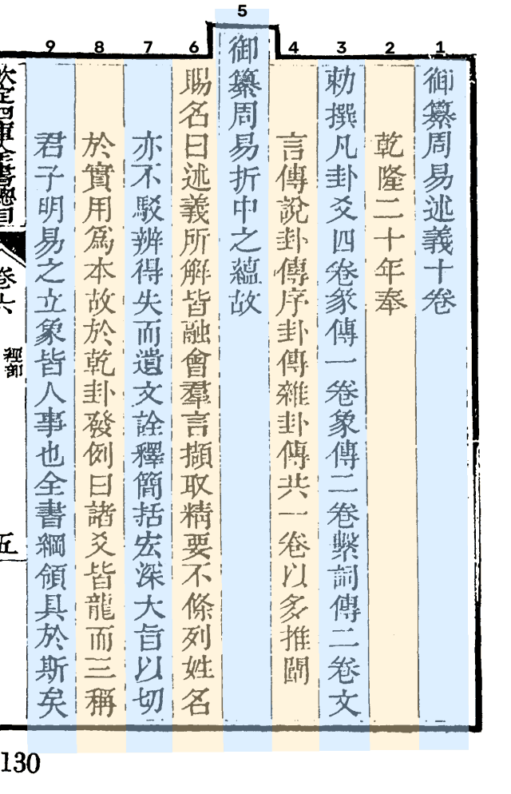
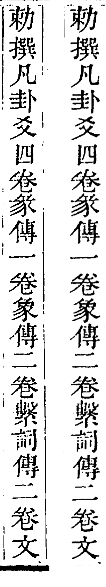

# Step2 单列拉直（`column_warp`）

*vol04 第 9 页，相邻两条界行之间就是一列，交替着色。列号从右往左数，和读的顺序一致；第 5 列是抬头列，比别的列高出一截。*

## 做什么

按 Step1 找到的界行，把每一列从原图上「抠」出来：两边的界行可能是斜的、弯的，这一步把这一条四边形（折线界行时是分段的）射影变换成一条笔直的竖条，同时清掉界行残墨、版框和噪点。之后的 Step3、Step4 都在这张**列图**上做，坐标再按 warp 参数换算回原图。

*vol04 第 9 页第 3 列。左：原图上沿界行裁出来的一条（两边还有界行和残墨）。右：拉直后的列图，界行清掉了。*

## 列图存哪里

列图不进产物包，存在本机缓存 `cache/`，缺了按产物现场重建（`guji cache column <册> --page N --col C`）。产物里只记 warp 参数、每列上下界（`top_y`／`bottom_y`）、上下端有没有版框残留（`triage`）。

## 出口闸 `column_gate`

挂在这一步上：每列判 ok／疑似／拒，拒的列（比如列宽和本页周期差太多、两列粘在一起）不进 Step3，交人看。闸的判据和分档见 [doc/segmentation_v2_pipeline.md](https://github.com/open-guji/open-guji-cv/blob/dev/doc/segmentation_v2_pipeline.md) Step 2 一节。

代码：`seg/warp.py`（单列射影、列窗口）、`seg/profile.py`（去噪、投影）、殿本的界行残墨剥法在 `impl/keben/column.py`、`column_triage.py`。
