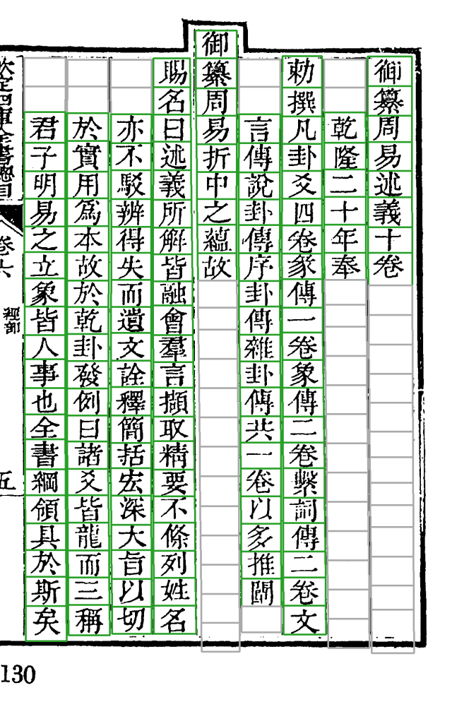
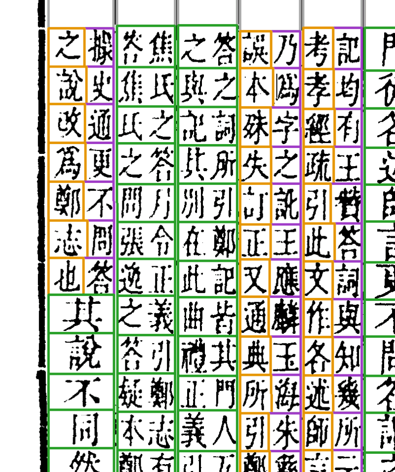
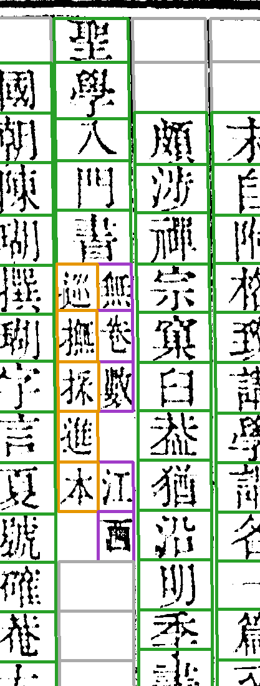
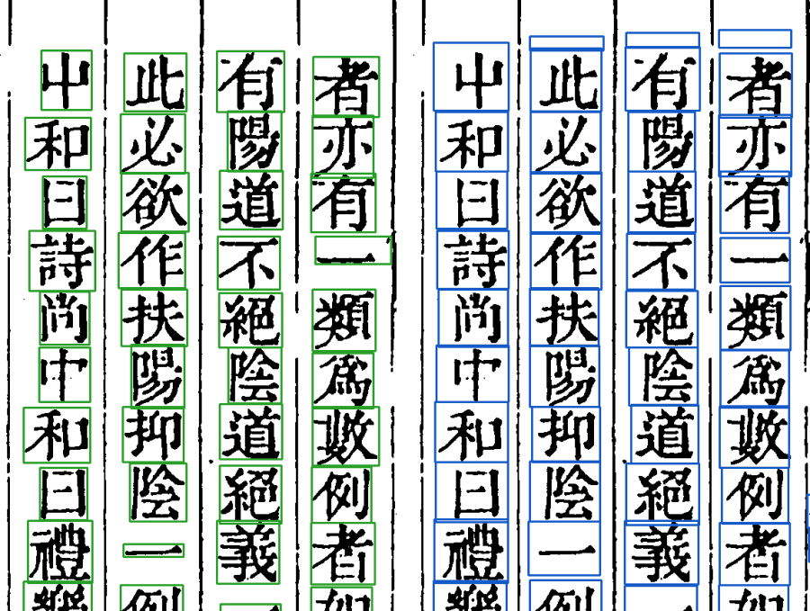
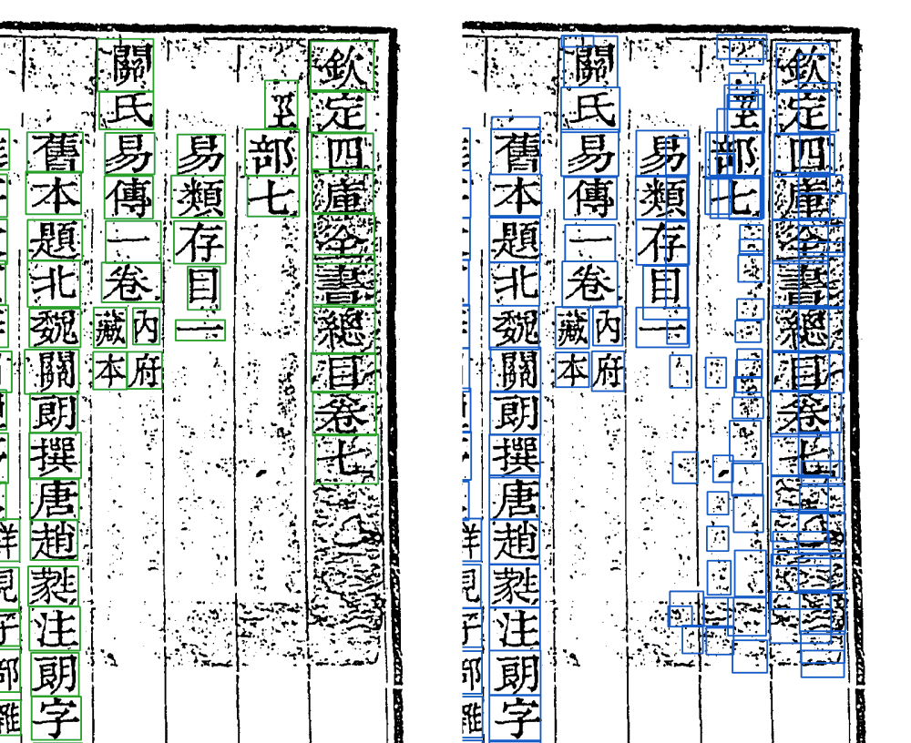

# Step3 逐字切分（`row_segment`）



*vol04 第 9 页的字格。绿框：字；灰框：空格（列头、列尾没字的格位也要占格，后面对位要用）。*

## 做什么

在 Step2 的列图上，把一列切成一格一格，每格标类型（字 `char`、空 `blank`、标点 `punct`），排好读序。殿本是**格位制**的：每列有固定的格数（正文 21 格），先按本页的行距建一张格位表，再在每个格位里找真正的切点。

- 切点不是简单的横线：字与字常常笔画相接，所以沿着「最省墨」的缝走（`seg/seam.py`），拿不准的切点交 U-Net 判官打分（`seg/cut_select.py`）。
- 职名页这种字距不定的列，参照整理本这一列的字数重切（`roster_ref`，史記职名页用得最多）。

## 夹注（双行小字）

正文里的小注是一格位里并排两行小字。切的时候整格先认出来，再左右劈开，读序是**先右行（a）后左行（b）**：



*vol16 第 6 页。紫框是夹注的右行（`sub=a`），橙框是左行（`sub=b`），绿框是正文大字。*

## 难例：双行小注长短不齐



*vol46 第 106 页第 4 列：「聖學入門書」五个大字之后接双行小注「巡撫採進本／無卷數　江西」，两行字数不一样多，左行比右行短，空出的位置不切格。*

## 和 YOLO 模型对照

切分有一个外部参照：[yolo-tool](https://github.com/open-guji/yolo_tool)。它用两段 YOLOv8 模型来切：先找版面框，再在框里找单字框，是另一套完全独立的做法。cv 在 `impl/keben/yolo_tool_infer.py` 里复刻了它的 ONNX 推理（只要 onnxruntime，装 `.[yolo]`），同一页图可以两边各切一遍，逐框比。

**同一页上比一比。** 下面每组图，左边绿框是我们的 Step4 紧框，右边蓝框是 yolo-tool 原生输出（2026-11-03 用现行模型重跑）。



*vol04 第 96 页右上。正文字两边几乎一一对上。两处口径不同：「一」我们只框墨迹，是扁扁一条，YOLO 框整个字格；YOLO 还常在列首空白处多出一个空框。*



*vol04 第 127 页（卷首）。大印扫成黑白后是一片麻点，YOLO 在上面打出几十个碎框，我们这边有印章定位兜着，印里不出字框。*

**整册的数**（vol04 全册 217 页，同一份图）：

| | 框数 | 说明 |
|---|---:|---|
| 我们的字框，YOLO 有对应框（IoU ≥ 0.3） | 34,012（98.95%） | |
| 落在 YOLO 某个框里，但重合不到 0.3 | 283（0.8%） | 几乎全是「一」，是上面说的框口径不同，不算分歧 |
| YOLO 没有框 | 77（0.2%） | 多在列首抬头位（「國朝」的「國」、「欽定」「聖祖」），YOLO 漏掉了 |
| YOLO 的框，我们这边什么都没有 | 1,741 | 印上的麻点、列首列尾空框、版心 |
| YOLO 一个框盖住我们两格 | 7 | 3 处在 vol04 第 65 页，是我们 Step1 界行拟歪、一格切在两字中间（已交给切分修），YOLO 这里是对的 |

10-19 在 vol04/05 的 100 页上做过一次逐列字数的正面对比（[doc/research/yolo_release_comparison.md](https://github.com/open-guji/open-guji-cv/blob/dev/doc/research/yolo_release_comparison.md)）。逐列字数全对率我们 96.6%，YOLO 原生 64.4%，加轻清理后 83.6%；单字框的查准、查全两边打平。两边的错几乎不重叠：我们会把横画字拦腰切开（「三」切成「一」＋「二」），YOLO 从不这样，但它会漏扁字、疏字，也会把版心当正文列。

**在什么情况下用它。** YOLO 不替代我们的切分，只在两处出场：

1. **当评测金标的一方。** 殿本 `column_counts` 评测的金标，是 daizhige 逐列本和一份「YOLO 粗切加人工修框」的成品各数一遍，两边字数一致的列才收（vol01–10 共 14,926 列）。见 [实验与评测](实验与评测#评测guji-eval)。
2. **当第二意见：YOLO 并格闸**（`row_segment.yolo_merge`，缺省关）。相邻两格落进同一个正常高的 YOLO 字框，就按少一格重切这一列，重切后对得上才采用。它只治「一个字切成两格」。

Step3 一共有三个结构先验开关，按这部书的整理本是什么样子来选：

| 整理本 | 开哪个 | 殿本 |
|---|---|---|
| 逐列、带格位（每列从第几格起、哪格空、夹注在哪） | 逐列格位约束 `layout_prior` | 开着（daizhige 逐列本） |
| 逐列，但只知道每列几个字 | 逐列字数先验 `colgold_prior` | 不开 |
| 没有整理本 | YOLO 并格闸 `yolo_merge` | 不开 |

殿本有逐列格位，开了 `layout_prior` 后已经没有列可让 YOLO 并格闸动，所以殿本不开它；它是留给没有整理本的书的。在殿本测试页上，它把逐列全对率从 97.0% 提到 97.8%，没有改坏的；在北行日錄 54 页上没有误并。新书要用，先当「疑似多切 → 送人看」，在本书上量过误并再改成自动并。选法的依据见 [doc/segmentation_v2_pipeline.md](https://github.com/open-guji/open-guji-cv/blob/dev/doc/segmentation_v2_pipeline.md)「Step3 结构先验：三个开关的名字与选法」。

## 怎么验

切分代码按套书分目录（`books/<套书>/`），每套书有一份**样页单** `samples.yaml`，列着 10–30 页以前出过问题的页。改切分的 PR 要在样页上比改前改后，变了的页逐页看图：

```bash
python scripts/seg_samples.py affected --base origin/dev     # 这次改动牵动哪几套书
python scripts/seg_samples.py submit --set affected --base origin/dev --cv <分支> --why "…"
```

细节：[doc/切分代码结构.md](https://github.com/open-guji/open-guji-cv/blob/dev/doc/切分代码结构.md)、行切分设计 [doc/design/row_boundaries_design.md](https://github.com/open-guji/open-guji-cv/blob/dev/doc/design/row_boundaries_design.md)、粘连与夹注 [doc/design/step3_touching_and_jiazhu.md](https://github.com/open-guji/open-guji-cv/blob/dev/doc/design/step3_touching_and_jiazhu.md)。
