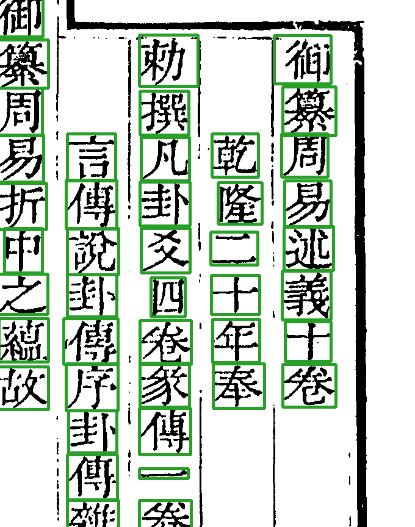

# Step4 字框收缩（`cell_shrink`）

*vol04 第 9 页右上：每个字收出来的紧框。整页没有带 flag 的字块，所以全是绿框；带 flag 的字块在叠图里画成红框。*

## 做什么

Step3 的格是格位，四周留着空白、邻字的笔画尖、界行残墨。这一步在格里认出**属于这个字的墨**，收成紧框，裁出字块图（`char_patch`），给 Step5 去比对。

*绿框：Step3 的格；红框：Step4 的紧框。「御」「撰」「述」取自第 9 页，「御」右边贴着界行，紧框把界行剥在外面；「諸」取自第 2 页，带 `boundary_ink`；「三」取自第 33 页，带 `edge_blob`，字身扁，上下收得很紧。*

## flag：这个字块可能有问题

收框时顺手体检，结果记在每个字的 `flags` 里，放行时会参考。vol04 全册常见的几种：

| flag | 意思 | vol04 格数 |
|---|---|---|
| `jiazhu` | 夹注小字 | 1,027 |
| `boundary_ink` | 格边上有墨被切断（可能切到了邻字或界行） | 499 |
| `seal_region` | 在印章区里 | 189 |
| `off_center` | 字明显偏离格中心 | 133 |
| `wide_gap` | 字和格边之间空得异常 | 106 |
| `edge_blob`、`tail_junk`、`lost_patch`、`suspect_empty` | 边上墨团、尾部杂墨、字块丢失、疑似空格 | 各十来格 |

## 剥框线

列首、列尾的格常常压着版框线。毛笔画的线两边拖着毛边，旧版只看紧挨线的两行，把毛边当成字连着线，整条不剥。`cell_shrink` 1.22 起越过毛边再找白行，碰到白行就连毛边一起剥（史記 01／02 册列首格残线 98→73）。

字块不进产物包，存在本机 `cache/`，缺了按产物重建：`guji product patch <册> --page N --col C --slot S --out x.png`。
