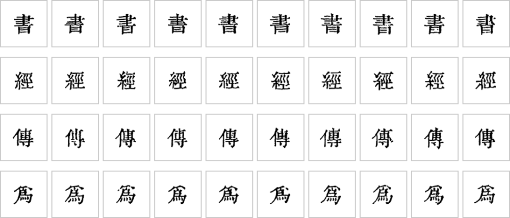

# Step5 识别三路（取证，不定字）

Step4 出来的每个字块，由三路各自去找证据。三路**互相独立、互不投票**，谁也不看谁的结果；把证据合起来下结论是 Step7 的事。

| 步 | 证据 | 一句话 |
|---|---|---|
| 5-a `glyph_match` | 形状 | 拿字块和**本书字形库**里已经人审确认的刻例比 |
| 5-b `rare_candidates` | 生僻字 | 字形库里没有的字，用字体模板＋CNN 找候选 |
| 5-d `align_ref` | 文本 | 把这一页对到**整理本**（维基文库等现成的录文）上，逐格给出整理本说的字 |

（5-c OCR 一路 2026-10-18 删了：OCR 的置信度不可信，「人／入」给 0.95 照样错。）

## 5-a 字形库匹配

*殿本字形库里「書」「經」「傳」「爲」的刻例，都是人审确认过、按书 ID（`96mid1ogzk`）收进库的（图里挑的是不贴邻字、没压界行的干净刻例）。同一个字刻出来大小、粗细、笔画轻重各不相同，字块要和这些刻例逐一比。*

做法：字块归一化后先用 HOG 特征找最像的几个刻例，再做弹性对齐算覆盖率 `cov`，分三档——

- **same**（`cov` ≥ 0.996 且形变小）：库里有，就是这个字；
- **unsure**（0.85 ≤ `cov` < 0.996）：进候选，交给后面判；
- **diff**（`cov` < 0.85）：库里多半没有这个字。

0.99 是实测的拐点：库判 same 的难例 27/27 全对。形近字家族（日曰、己已巳、入人八……）另有护栏，见 [字组与异体](字组与异体)。

字形库一书一个，存在中心库，按版本钉（`glyph_pin: N`），平时重跑不会因为别人刚推了人裁就变，见 [产物与数据](产物与数据)。

## 5-b 生僻字候选

字形库只收见过的字。没见过的（生僻字、异体字）用三个来源融合排名：字体模板（拿几套古籍字体渲出来的字形比）、CNN 分类头、CNN 向量检索。整页批处理，checkpoint 缺了不报错，退回纯字体候选。放行时它要和整理本说的同一个字，才走 `rare_ref` 通道放行。

## 5-d 整理本对位

整理本是这本书现成的电子录文（殿本用的是文淵閣本系统的《四庫全書總目》录文），版本、行款都不一定和影印本一样；语料按版本钉在册配置里（`corpus: N`）。对位有两种：

1. **锚定＋比对**：拿每格字形库最有把握的字连成串，用 8-gram 在整理本里找锚点，再逐字比对（`difflib`），得出每格 `equal`／`replace`／`insert`。
2. **坐标对位**（`align: coord`）：行款一致的书，按「第几列第几行」逐格配字；印章压住、字形认不出时也配得上。格数对不上就退回第 1 种。

整理本是**文本证据**：它在场时有一票否决权，但它自己也会错（缺字图占位、异体字录成通行字），所以不能单独放行，要和形状证据凑成双信号。

细节：[doc/design/Step5-7-操作一览.md](https://github.com/open-guji/open-guji-cv/blob/dev/doc/design/Step5-7-操作一览.md)、字形匹配 [doc/design/glyph_match_stack.md](https://github.com/open-guji/open-guji-cv/blob/dev/doc/design/glyph_match_stack.md)、字形库优先设计 [doc/design/glyph_db_first_design.md](https://github.com/open-guji/open-guji-cv/blob/dev/doc/design/glyph_db_first_design.md)。
