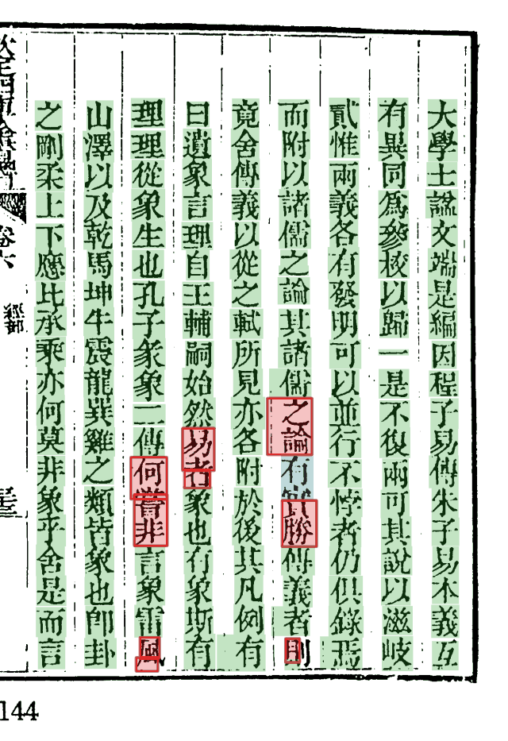
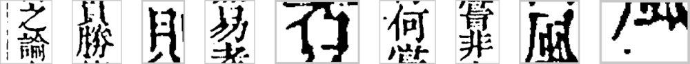

# Step6–7 定字与放行

*vol04 第 65 页的放行结果。绿底：自动放行；蓝底：人审定过；红框红底：落人审。这一页落审的 9 格多数是**切错的格**：一格骑在两个字中间（「之論」「何嘗」），字形对不上任何字，整理本也对不齐，所以放不了。*

## Step6 上下文裁决（`context_decide`）

把字形库的候选按同一列的前文重排：本书语料的 3-gram 占 0.9，通用语料 0.1。两条铁律：

- **只在候选里挑**，不会凭上下文造出一个字形上没有的字；
- **门槛化**：语义上领先够多（margin ≥ 0.70）才动，拿不准就不动。

读序按阅读顺序，夹注先右行后左行，跨列不接。

## Step7 放行（`seed_admit`）

把三路证据和上下文合起来，每格给出两种结论之一：**自动放行**（定了字，随后进字形库）或**落人审**。四条原则：

1. 整理本在场时，它有一票否决权；
2. OCR 只供候选，置信度不参与任何自动判断；
3. 字形库匹配按 `cov` 分档采信，0.99 是拐点；
4. 凑双信号要挑**误差独立**的两路：文本×形状可以，OCR×形状不行（错例里两者常同错）。

满足哪种组合就走哪条**通道**。vol04（cv 0.5.26 的 main 包）34,471 格的去向：

| 通道 | 格数 | 什么情况 |
|---|---:|---|
| `match_ref` | 32,211 | 字形库和整理本说的是同一个字 |
| `human` | 622 | 以前人审定过（人裁事件回流） |
| `rare_ref` | 578 | 生僻字候选和整理本一致 |
| `context` | 183 | 上下文过了门槛，且与其它证据不冲突 |
| `match_replace` | 171 | 这格在整理本对位里属于改字段（replace），但字形库首位与整理本同字、cov 够高 |
| `seal` | 158 | 印章遮挡格，按印章区规则 |
| `witness3` | 158 | 待审格里，其它版本录文（证人）、整理本、坐标对位三方说同一个字 |
| `group_flow` | 83 | 形近字组的专门流程判定 |
| `match_solo` | 77 | 无整理本参照，字形库 cov ≥ 0.99 |
| 其它（`coord_fallback` `note_lexicon` `split_ref` `ref_lib` `iron` …） | 150 | 各种补放与规则 |
| **落人审** | **80**（0.23%） | |

同一时期殿本其它几册的落审率在 0.23%–0.38% 之间。

## 落人审的格长什么样

每格都记着为什么放不了（产物里的 `doubts`），如：

| 原因 | 意思 |
|---|---|
| 库里没有这个字（`diff`） | 字形对不上库里任何刻例 |
| 上下文 margin 不足 | 候选之间语义上分不出高下 |
| `ctx_garble_shape` | 上下文想改，但字块形状像乱码，不让改 |
| `replace_align`、`context_vs_ref` | 整理本和上下文说的不是同一个字 |
| `near_form`、`group_flow_abstain` | 形近字组，组内流程弃权 |

落审的格出成待审单，由人在控制台或网站上定字；人裁记成事件，回流后这格走 `human` 通道（审单、投票、回流在 guji-manager 一侧）。

## 闸：拦住不该放的

放行前还有一串护栏，把本来会放的格拦回人审，如：遮挡／印章、上下文乱码与空白与窄格、异体间接路径（`variant_indirect_guard`）、影子模型否决（`shadow_veto`）、己已巳永远人审（`always_review`）。

开关和通道的完整清单：[doc/design/Step5-7-操作一览.md](https://github.com/open-guji/open-guji-cv/blob/dev/doc/design/Step5-7-操作一览.md)、[doc/开关登记表.md](https://github.com/open-guji/open-guji-cv/blob/dev/doc/开关登记表.md)。
