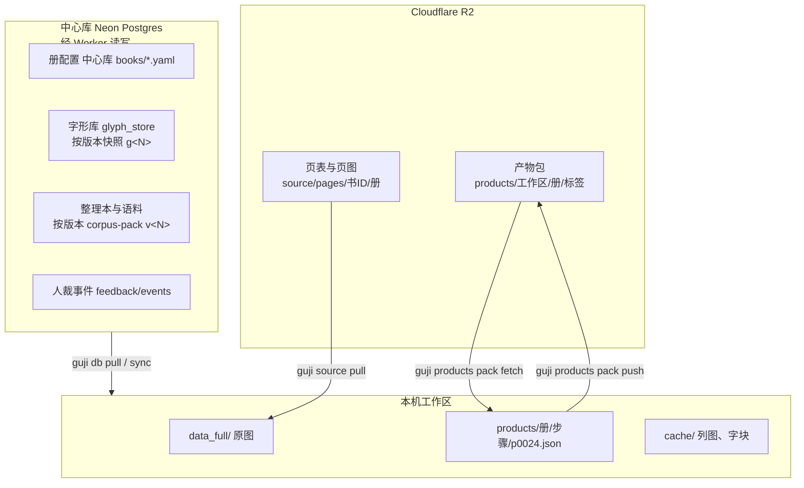

# 产物与数据

## 三处存储



| 放在哪 | 放什么 | 怎么取 |
|---|---|---|
| **中心库**（唯一的家） | 册配置、字形库、整理本与语料、人裁事件、台账 | `guji db pull／sync／push` |
| **R2** | 原图（页表＋按 sha 存的页图）、产物包 | `guji source pull`、`guji products pack fetch` |
| **工作区 git 仓**（`guji-workspace/<书ID>-…`） | 只剩 `workspace.yaml`、`.central.json` 和说明 | `git clone` |
| **本机** | 原图副本、产物、缓存（列图、字块） | 上面几条拉下来；跑管线时生成 |

## 产物长什么样

每步每页一个 JSON：`<工作区>/products/<册>/<步骤>/p0009.json`，同目录 `_manifest.jsonl` 逐页记指纹、sha256、上游指纹、`cv_version`。叠图看产物：

```bash
guji product show vol04 seed_admit --key p0009 -w <工作区>          # 看 JSON
guji product overlay vol04 row_segment --page 9 --out p9.png -w <工作区>
```

产物格式（`pages.json`、`guji-page`、`guji-format`、char／cord 导出）见 [doc/formats/](https://github.com/open-guji/open-guji-cv/tree/dev/doc/formats)。

## 产物包与 main

一册跑完，整册产物打成一个包存 R2，带标签（`cv0.5.26-c18-g10-…`：cv 版本、语料版本、字形库版本、改动名）。每册有一个包标 **main**，就是这一册当前的正式结果，网站和下游都读它：

```bash
guji products pack list vol04 -w <工作区>      # ★ 是 main
guji products pack fetch vol04 -w <工作区>     # 取 main 到本机
```

只有正式版 cv（打过 tag 的 `X.Y.Z`）跑出的包能标 main。

## 钉版本

一册要让数字可比、可复现，册配置里钉 cv 版本和四个库（v0.7 起四库统一写「字母＋整数」）：

- `cv_version: "0.7.0"`：装的 cv 不是这个版本就拒跑；
- `corpus: N`（c）：整理本与语料用第 N 版；
- `glyph_pin: N`（g）：字形库用快照 g<N>（只读）。不钉的话，任何人推一条人裁都会让本册放行判过期；
- `model: N`（m）：训练好的模型用第 N 版清单；
- `code: N`（k）：书仓 `code/` 用 k<N>，工作副本和 `code/releases/k<N>.json` 对不上就拒跑。

也可以合写成一行 `pin: c31-g19-m2-k3`；产物包标签写成 `cv0.7.0-c31-g19-m2-k3-<改动名>`。

模型文件 v0.7 起不进 git：cv 只带路径 → sha256 表（`config/model-registry.json`），起跑前、测试前、装发版包时自动从 R2 取回（要读令牌）。

在没发版的代码上做实验：上中心库**实验分支**（`GUJI_DATA_BRANCH=exp/…`），产物、字形库都落在分支自己的目录，不碰正式数据。

细节：[doc/datastore.md](https://github.com/open-guji/open-guji-cv/blob/dev/doc/datastore.md)、[doc/版本号规矩.md](https://github.com/open-guji/open-guji-cv/blob/dev/doc/版本号规矩.md) 第五、七节；中心库、册配置、产物包的操作手册在 guji-manager 仓 `doc/参考/`。
