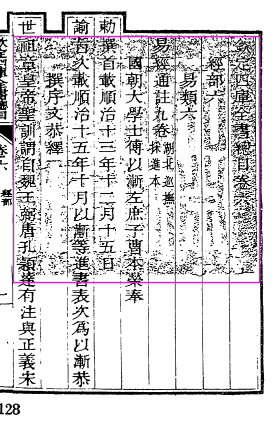
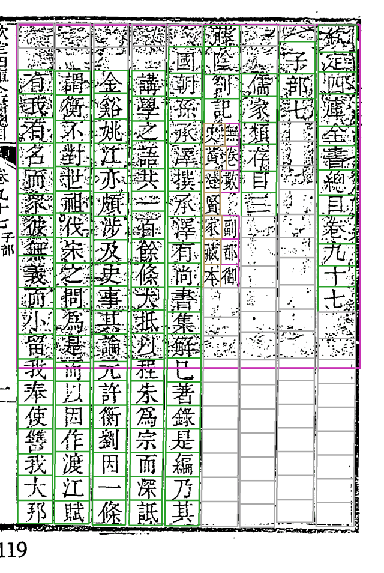
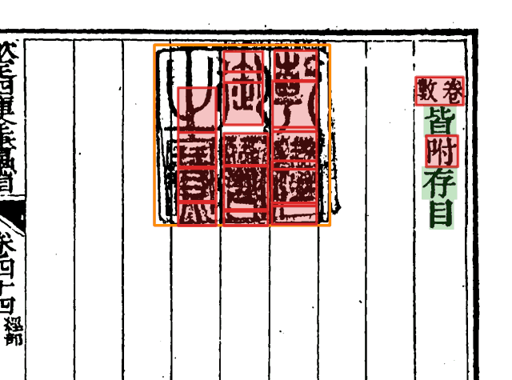

# 印章（`seal_detect`）

*vol04 第 1 页（卷首）。品红框是认出来的大印：一方很大的淡朱印压在前几列正文上，扫成黑白后成了一片麻点。*

## 做什么

在原图上找出每一方印，分两类：**大印**（`stain`，卷首、卷末那种盖在正文上的收藏印、御览印，按版框定成正方形）和**小印**（`crisp`，边缘清楚的小方印）。后面各步认印只读这一步的产物，不各自再找。

印压着的字格有两件事要处理：

1. **切分**：印文的笔画会被当成墨，挤歪列、切错格。Step2–4 知道哪里有印，去噪、切点、收框时绕开。
2. **识别**：被印压着的字，字形对不上字形库，要靠整理本和上下文定；印里的空格子不能当成字。这些格记成「遮挡格」，在 Step7 走专门的放行规则，见 [Step6–7 定字与放行](Step6-7-定字与放行)。

## 例子

**大印下的列照样切。** vol46 第 101 页是卷九十七的卷首，一方大印盖住上半页（品红框），印下第 4 列「藤陰劄記」后面还有双行小注，照样切成左右两行小格：

**卷末印页的空栏。** vol21 第 225 页是卷末，正文只到「卷數皆附存目」，后面几列是一方「乾隆御覽之寶」压着的空栏。橙框是小印；红框红底是落人审的格，绿底是自动放行：

这一页就是 CHANGELOG「卷末印页的空栏不再人审」那条（`align_ref` 2.5、`seed_admit` 1.29）讲的例子：印压着的列已经过了整理本这半叶的末行，印里的格默认字来源记 `coord_blank`，交给印章区规则判非字，不必人看。图用的是 0.6.1 开发版的实验包，下次 MINOR 重截时以新版产物为准。

## 书级配置

- `seal_detect.stain_pages`：只在这些页找大印（史記各册真印只在首叶，别的页纸面底纹会被误认成大印）。
- `seal_detect.overrides`：逐页点名挡印（史記卷末大印压职名列）。

设计与判据：[doc/design/印章遮挡格-判据与放行.md](https://github.com/open-guji/open-guji-cv/blob/dev/doc/design/印章遮挡格-判据与放行.md)。
