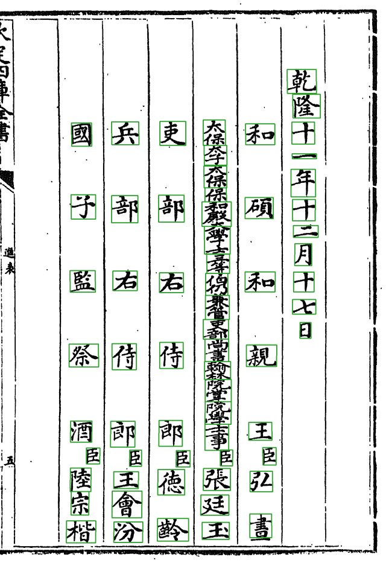
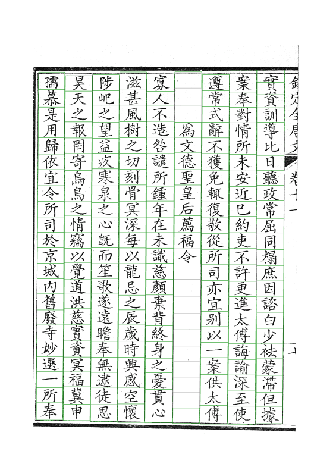
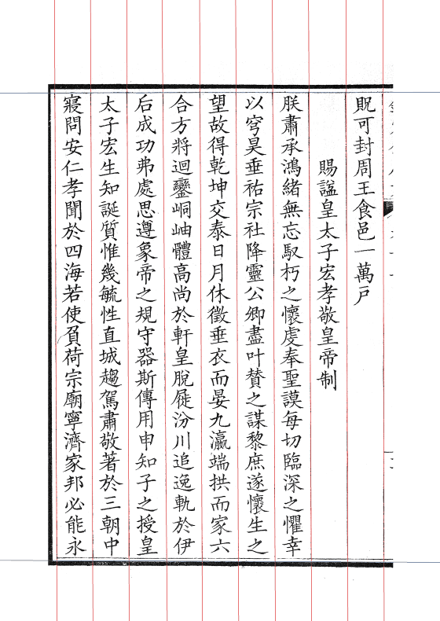
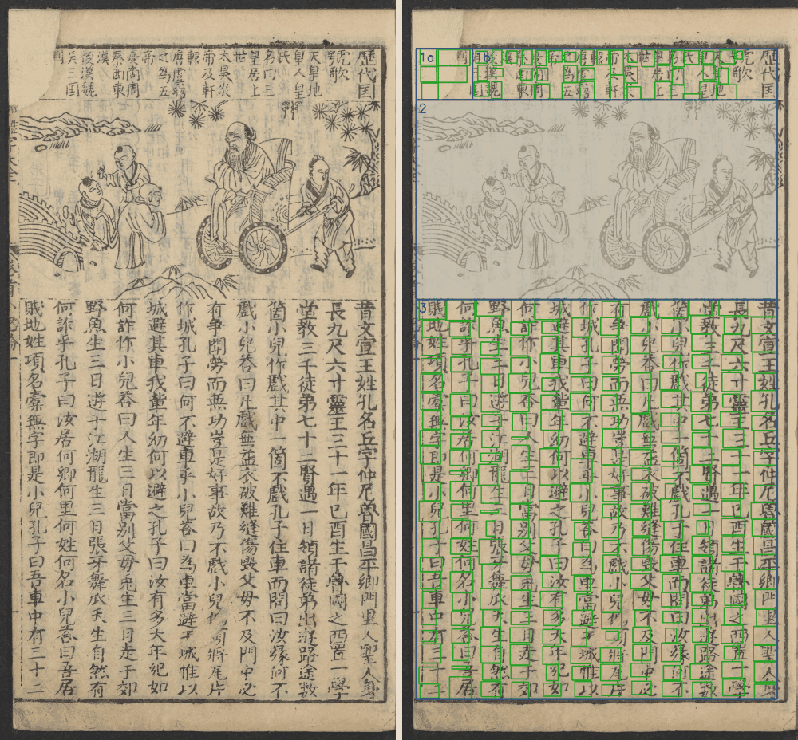

# 各书一览

重点是**殿本四庫總目**，另有**史記文淵閣本**、**全唐文**两部在做；北行日錄、幼學鰲頭只是试点。

切分代码按「套书」分目录（`open_guji_cv/books/<套书>/`），一套版式一个目录，套书之间不互相 import；共用的找线、拉直、走缝等原语在 `seg/`。册配置里 `seg_set:` 指定这册归哪套，不写就按管线归（刻本正文归殿本这套）。

| 书（book-index ID） | 套书 | 管线 | 规模 |
|---|---|---|---|
| **《欽定四庫全書總目》武英殿刻本**（`96mid1ogzk`） | `siku_zongmu` | keben_body_v2 | 99 册，16,640 页 |
| **《史記》文淵閣四庫全書本**，写本（`988g3f0wsu`） | `shiji_wyg` | keben_body_v2 | 10 册 |
| **《欽定全唐文》**CADAL 清華本（借 `995ejelvk0`，工作区 `qtw-draft`） | 殿本这套 | keben_body_v2 | v006–v010 五册，520 页 |
| 《北行日錄》知不足齋叢書本（`988g7gsqhd`，册 `bxgb`） | 殿本这套，网格模式 | keben_body_v2 | 1 册 56 页 |
| 《增廣幼學須知鰲頭雜字大全》（`998a1ukohs`，册 `yxat`） | `zengguang_youxue` | keben_free | 1 册 126 页，试点 |

## 殿本四庫總目

见专页 [殿本四庫總目](殿本四庫總目)。

## 史記文淵閣本（写本）

*01 册第 32 页，正文。手写，字形比刻本更不统一，列首列尾常压着毛笔框线（`cell_shrink` 1.22 起连毛边一起剥，见 [Step4](Step4-字框收缩#剥框线)）。*

职名页和卷末大印压职名列是这部书的难点，由 `books/shiji_wyg/roster_segment.py`（从殿本分叉）按整理本字数切：

*左：01 册第 40 页，职名页，官衔大字、「臣」小字偏右、人名两三字，字距完全不规则。右：第 139 页，「乾隆御覽之寶」大印（品红框）压在空栏上，左边是总校官等职名。*

- 真印只在首叶，别的页纸面底纹会被误认成大印，书级配 `seal_detect.stain_pages`；
- 年表（09、10 册大半）暂时整页跳过，见 [页型、表格页与插图](页型表格页与插图)。

## 全唐文（CADAL 清華本）

*v006 册。左：第 20 页的字格（「為文德聖皇后薦福令」一列是题目，下面空格）。右：第 40 页的版框与界行。*

刻本、半叶九列，版式和殿本接近，所以直接借殿本这套切分；字形库是自己的（edition 只含全唐文刻例，写 Wiki 时约 6,500 例），入人八按本书刻形判（`groups/rr_shape.py`，「字形说了算，越过整理本」）。原图来自 CADAL，书 ID 暂借 book-index 里的全唐文条目。

R2 里还没有这几册的产物包，这两张图是写 Wiki 时在云端会话里拿 v006 跑 Step1–4 出的。数据流说明：[doc/research/字形库/全唐文数据流-唯一真源.md](https://github.com/open-guji/open-guji-cv/blob/dev/doc/research/字形库/全唐文数据流-唯一真源.md)。

## 北行日錄（知不足齋本，试点）

*第 20 页（一张对开）。界行印得残缺，按线找不全，所以整书走**网格模式**（`seg/grid.py`）：列数已知、列距均匀，逐个格位验线，缺的插值补上。*

## 幼學鰲頭（自由版式，试点）

*第 9 页：上下分栏、中间插图（灰底跳过），走另一条管线 `keben_free`：先按框线拉正、分块，块里找列、切字。只在这一册上试，还没整册跑。设计见 [doc/design/自由版式切分-游学鳌头.md](https://github.com/open-guji/open-guji-cv/blob/dev/doc/design/自由版式切分-游学鳌头.md)。*

## 接新书

先看它像哪一套：像就在册 yaml 写 `seg_set: <套书>`（全唐文、北行就是借殿本这套）；差得远就复制最接近的一套新建目录，在 `core/seg_set.py` 登记，写自己的样页单 `samples.yaml`。新建套书要动 `core/seg_set.py`，找架构维护人（A20）。

详见 [doc/切分代码结构.md](https://github.com/open-guji/open-guji-cv/blob/dev/doc/切分代码结构.md)、[doc/runbook/新书开工与首次走任务库.md](https://github.com/open-guji/open-guji-cv/blob/dev/doc/runbook/新书开工与首次走任务库.md)。
