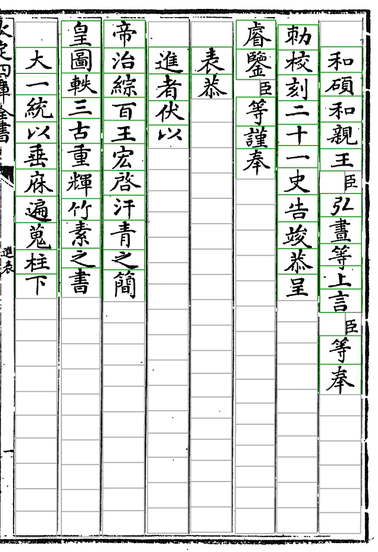
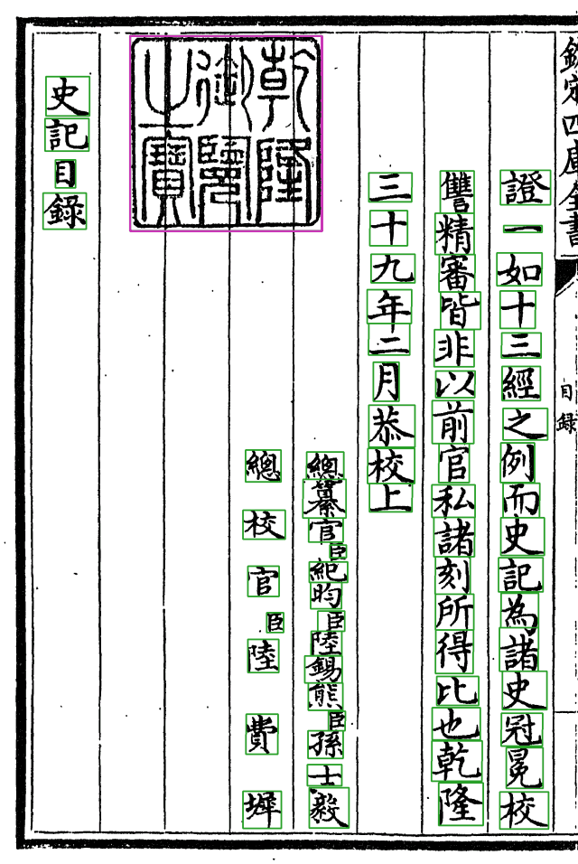
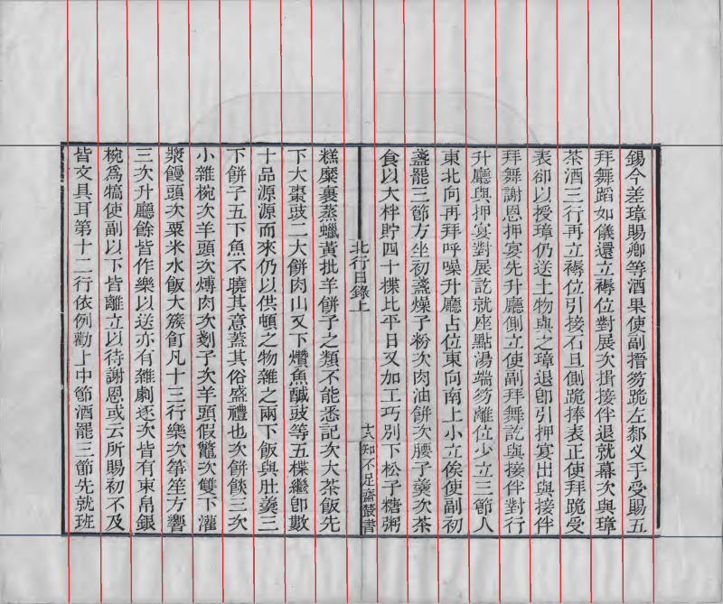
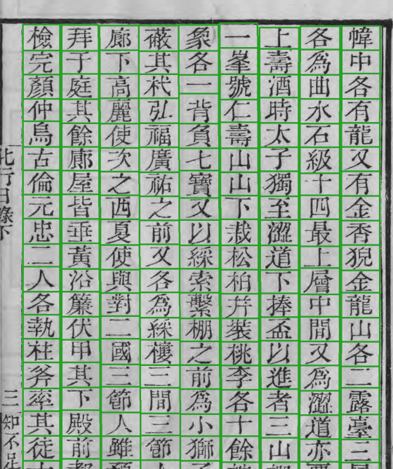

# 各书一览

切分代码按「套书」分目录（`open_guji_cv/books/<套书>/`），一套版式一个目录，套书之间不互相 import；共用的找线、拉直、走缝等原语在 `seg/`。册配置里 `seg_set:` 指定这册归哪套。

| 套书 | 书（book-index ID） | 管线 | 规模 |
|---|---|---|---|
| `siku_zongmu` | 《欽定四庫全書總目》武英殿刻本（`96mid1ogzk`） | keben_body_v2 | 99 册（200 卷＋卷首四），16,640 页 |
| `shiji_wyg` | 《史記》文淵閣四庫全書本，写本（`988g3f0wsu`） | keben_body_v2 | 10 册 |
| `siku_zongmu`（借用） | 《北行日錄》知不足齋叢書本（`988g7gsqhd`，册 `bxgb`） | keben_body_v2，网格模式 | 1 册 56 页 |
| `zengguang_youxue` | 《增廣幼學須知鰲頭雜字大全》康熙文萃堂刻本（`998a1ukohs`，册 `yxat`） | keben_free | 1 册 126 页 |
| `beixing` | 《北行日錄》现代排印本（`bxrl`） | modern_body | 本机数据 |

## 殿本《四庫全書總目》

主力书，本 Wiki 多数截图都来自它。半叶九列、每列 21 格，有抬头、夹注、大印、卷末印。原图由 Wikimedia Commons 上的 DjVu 登记到 R2（页表），2026-10 下旬全书换成重新切分的图源（`siku-qiefen-v2`，页号重编）。

## 史記文淵閣本（写本）

*01 册第 32 页，正文。手写，字形比刻本更不统一，列首列尾常压着毛笔框线。*

职名页和卷末大印压职名列是这部书的难点，由 `books/shiji_wyg/roster_segment.py`（从殿本分叉）按整理本字数切：

*01 册第 139 页：「乾隆御覽之寶」大印（品红框）压在空栏上，左边是总校官等职名，人名旁小字「臣」。*

年表（09、10 册大半）暂时整页跳过，见 [页型、表格页与插图](页型表格页与插图)。

## 北行日錄（知不足齋本）

*第 20 页（一张对开）。这部书界行印得残缺，按线找不全，所以整书走**网格模式**（`seg/grid.py`）：列数已知、列距均匀，逐个格位验线，缺的插值补上。*

*第 41 页右半叶的字格。*

## 增廣幼學須知鰲頭雜字

上下分栏、大字夹小注、插图，走自由版式管线，见 [自由版式](自由版式)。

## 接新书

先看它像哪一套：像就在册 yaml 写 `seg_set: <套书>`；差得远就复制最接近的一套新建目录，在 `core/seg_set.py` 登记，写自己的样页单 `samples.yaml`。新建套书要动 `core/seg_set.py`，找架构维护人（A20）。

详见 [doc/切分代码结构.md](https://github.com/open-guji/open-guji-cv/blob/dev/doc/切分代码结构.md)、开新书的流程 [doc/runbook/新书开工与首次走任务库.md](https://github.com/open-guji/open-guji-cv/blob/dev/doc/runbook/新书开工与首次走任务库.md)。
