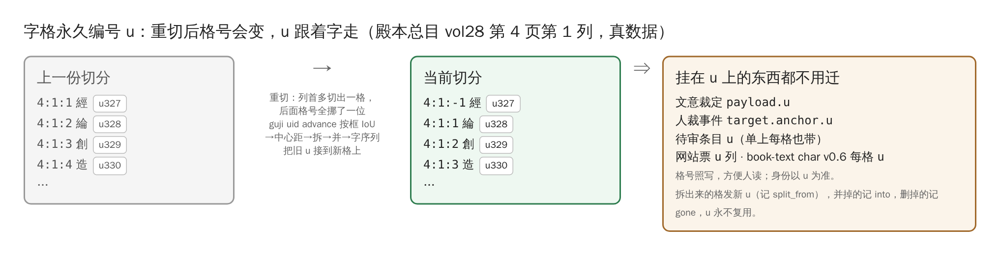

# 字格永久编号 u（cv 侧）

> 2026-11-26 写。u 怎么发号、身份账长什么样、存量怎么迁，看 guji-manager Wiki 的 [字格永久编号 u 与身份账](https://github.com/open-guji/guji-manager/wiki/字格永久编号u与身份账)。这一页讲**图像引擎这边**：cv 在哪里用 u、怎么给一部书打开、出了问题先查什么。字段与版本号的准确清单在仓里 [doc/参考/字格永久编号u.md](https://github.com/open-guji/open-guji-cv/blob/dev/doc/参考/字格永久编号u.md)。

## u 是什么

格号（`册:页:列:格`，如 `vol28:4:1:3`）是切分出来的**位置**。重切、换图源、列首多切一格，后面的格号就整列挪一位。挂在格号上的东西（文意裁定、人裁、待审条目、网站票）每次重切都得跑一遍「旧格→新格」去迁，迁不准就丢。

**u** 是册内唯一的正整数，发给一格后跟着这个字走，永不改、永不复用。重切以后格号变了，u 不变。



*殿本总目 vol28 第 4 页第 1 列（真数据）：列首多切出一格，「經」从 4:1:1 变成 4:1:-1，后面的格号全挪一位；u327、u328…都没变。*

谁管什么：

| | 谁做 |
|---|---|
| 发 u、记身份账 `feedback/uid/<册>.jsonl` | guji-manager（`guji uid …`；标 main 时自动入账） |
| 人裁、裁定、待审条目、网站票、book-text 上写 u | guji-manager |
| **按 u 查文意裁定** | **cv**（`seed_admit`，书级开关 `ruling_by_u`） |
| 产物里带 u | 不带。cv 产物仍只写格号，u 在导出 book-text 时由 manager 按账补上 |

## cv 怎么用 u：查文意裁定

第 4 步定字的 4c 放行（`seed_admit`）里，形近字组、待审格会去查大模型的**文意裁定**库（之前问过的就不再问）。以前只能按「这格前后的文字」做键去查；前后文一改（整理本改字、旁边的格重切），就查不到。打开 `ruling_by_u` 以后多了最后一档：


按 u 查到的裁定还要过护栏才用：只收高置信（`conf=high`），前后 2 字至少一侧和裁定当时一样，裁定的字在字形库候选里或等于整理本的字；同一格两条裁定说的字不一样就不放行。命中的格在产物里记 `ruling_key: "u"`。

字组流程「在线问大模型之前先查缓存」那一步也一样：窗口键没中再按 u 查，但要求提示词版本**完全相同**。

**实例**（史記 11-25 补跑，和 v0.2 main 逐格比）：20 册 66:8:10，原来落待审（机器拟「兮」），按 u 找到文意裁定改放「公」：上下文是「孫文子寗惠子共立定**公**弟秋為衞」，对；35 册 42:6:9 同样由「恕」改放「如」：「集解**如**淳曰」，对。殿本 vol01–20 开了以后与原 main 逐格比较，新命中的都是人裁或裁定，放错 0 格。

## 怎么给一部书打开

在中心库数据目录的书级缺省 `config/book_defaults.yaml`（或某一册的册配置）里写：

```yaml
params:
  seed_admit:
    ruling_by_u: true
```

推库，然后从 `seed_admit` 起重跑（任务库 `guji pipeline job submit … --from seed_admit`，缺省就是 force）。要点：

- 开关缺省关，关着的书产物一个字节都不变。
- 打开的那几册 `seed_admit` 起往下判过期，这是预期的。
- 身份账和裁定都是**数据**，不进产物指纹：账有了新页、或者新写了一批带 u 的裁定，`guji status` 不会报过期，要自己从 `seed_admit` 起 force 重跑。
- 书得先有身份账（manager `guji uid init`／标 main 自动入账）。账里查不到这一页这次切分的，就当这页没有 u，**不会退回去按格号查**。

殿本、史記、全唐文 2026-11-25 起已经整部书打开。

## 用哪个 cv 版本

| 书 | 最早能开的版本 | 整理脚本导出带 u 的版本 |
|---|---|---|
| 跟 dev／v0.9 的书（脈經、北行等） | v0.9.1 | dev 本来就走 manager 导出 |
| 殿本 patch 线 | v0.7.102 | v0.7.108 起整理脚本导出带 u（`zl` 自 v0.7.110） |
| 史記 patch 线 | v0.7.103 | v0.7.107／v0.7.112 |
| 全唐文 patch 线 | v0.7.104 | v0.7.109／v0.7.111 |

**整理脚本导出**指整理脚本（`scripts/zhengli/zl.py` 等；`republish.py`、`proof_cycle.py` 已于 2026-11-27 退役删除）出 book-text 用的 char 导出。上表版本起它们改调 guji-manager 的导出器（要 manager ≥0.6.20，`zl` 要 ≥0.6.21），册有身份账时每格带 `u`（char v0.6）。版本不够时出的导出不带 u，推 book-text 会报「旧版已有 u，新版把 u 全丢了」。遇到先升 cv、把 `_cycle/*/export` 重出一遍。这几处只改脚本，产物指纹不变，钉旧版的册不用改钉。

## 两件 cv **不**按 u 做的事

### 人裁绑定

裁定事件里 manager 会写 `target.anchor.u`，但 cv 把人裁落到格上时（`bindings.py`）**仍按锚框和图像指纹**找格，不按 u。原因是绑定表本来就靠原图坐标，跨重切是稳的，不需要 u。

这带来一个要注意的地方：u 迁移时给旧人裁抄的 `~u` 件（id 后缀 `~u`）如果只有 u、没有框，cv 找不到格，会判 `unanchored`、不采信这条人裁。11-25 殿本 vol16 就有 3 条网站精校人裁因此退回待审。manager `guji uid anchor-fill` 已经按身份账给全库 `~u` 件补了框，补完从 `seed_admit` 重跑就回到 `human` 通道。以后再迁裁定事件也必须带锚。

### 字形库刻例的键

字形库里每个刻例的 id 是入库那一刻的格号（`v2:册:页:列:格`）。**重切后不改键**：cv 读库时拿刻例的原格号去找同一格号的裁定事件，看那条事件现在绑到哪一格，跟着落过去。事件不改键，库也不改键，两边才对得上；只改库的键，就会对上新格号上别的字的事件。`guji feedback rekey-cells` 只在换图源（事件也一起迁）时用。

## 出了问题先查什么

| 现象 | 先查 |
|---|---|
| 开了 `ruling_by_u` 但没有任何 `ruling_key: "u"` | 账里有没有本页**当前**切分那一行（`guji uid show <册> --cell <格号>`）；裁定库里有没有带 `u` 的裁定；有没有从 `seed_admit` 起 force 重跑 |
| 重跑后人裁格退回待审，`human_unbound.event` 以 `~u` 结尾、`status: unanchored` | 那条 `~u` 件没有锚框，补锚（manager `guji uid anchor-fill`）后重跑 |
| 推 book-text 报 u 全丢了 | cv 版本是否到上表「整理脚本导出带 u」那一列；导出是不是旧版出的 |
| 标 main 后账尾没有新行 | 切分没变时只记一行册级 `src=sync`；什么都没有就 `guji uid sync <册> --label <包>` 补 |

相关页：[4 定字](4-定字)、[字组与异体](字组与异体)、[产物与数据](产物与数据)。
