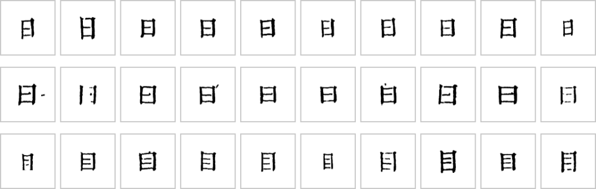

# 字组与异体

*殿本字形库里「日」（上）、「曰」（中）、「目」（下）的刻例。刻本上「日」「曰」只差中间一横是否顶到右边、字身是方是扁，单看一个字块常常分不清；这类字自动放行最容易错，所以单独成组来判。*

## 为什么要单独处理

字形库匹配对绝大多数字很可靠，但有两类字它管不了：

| 类型 | 例子 | 难在哪 | 靠什么判 |
|---|---|---|---|
| **形近字**（不同义，`near_form`） | 日／曰／目、己／已／巳、入／人／八、門／鬥 | 字形几乎一样，意思完全不同 | **看文意**：前后文、整理本、大模型 |
| **异体字**（同义，`variant`） | 却／卻、内／內、旣／既、眞／真 | 意思相同，刻法不同，录哪个码位要定规矩 | **看刻形**：按笔画差别拆，或按书定一个码位 |

每个这样的组在注册表 `groups/registry.py` 里登记成员、类型和判法（一串方法：整字 HOG、取框比部件、文意规则、L2 小模型、L3／L4 问大模型……），由统一流程 `group_flow` 依次试，谁有把握谁说话，都没把握就落人审。

## 异体录哪个码位

同义的一对，有几种结局，按书定：

- **按刻形拆开**：两种刻法都有、看得出差别，就照刻的录（字组按刻形判）；
- **照录刻形**：这部书每对只一种刻法，跟着刻形走（殿本 旣、淸、靑）；
- **真归一**：刻形分不清，书里定用哪一个（殿本 内、別、卷）；
- **暂归一**：现在分不清、以后攒够人裁再拆，单独登记（殿本 鎭、刋）。

**形近字绝不归一**（个／今不能因为像就并成一个）。码位归一表在中心库 `config/codepoints.yaml`。

## 去哪看

- 规范与入口：[doc/字组/README.md](https://github.com/open-guji/open-guji-cv/blob/dev/doc/字组/README.md)；一组一张卡 `doc/字组/<组 id>.md`；
- 有哪些组：[doc/字组/字组总表.md](https://github.com/open-guji/open-guji-cv/blob/dev/doc/字组/字组总表.md)（`guji groups table` 生成）；
- 方法论（什么组用什么方法、换书怎么做）：[doc/字组/方法论/](https://github.com/open-guji/open-guji-cv/tree/dev/doc/字组/方法论)；
- 异体总策略：[doc/design/variant_strategy.md](https://github.com/open-guji/open-guji-cv/blob/dev/doc/design/variant_strategy.md)。
