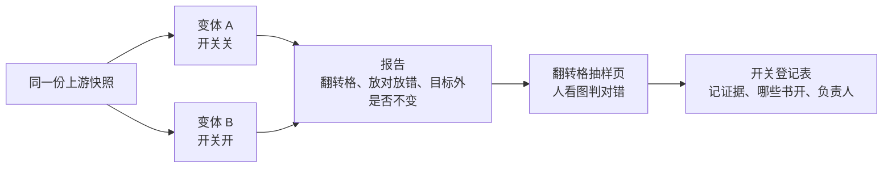

# 实验与评测

## A/B 实验（`guji exp`）

回答「这个开关开不开、对哪本书有效、会不会让别处变坏」：



```bash
guji exp run --base A.yaml --var B.yaml --books vol04,vol05 --from seed_admit --snapshot <快照> -w <工作区>
guji exp report <实验名> -w <工作区>
```

- 上游各步从快照硬链接，各变体只重跑 `--from` 之后的步；框架不动任何 Step 代码，不会让各书产物过期。
- 报告看三件事：目标对象变了多少、放对放错多少、目标以外的格是不是逐格不变。
- 会写库的实验上中心库**实验分支**，不碰正式数据。
- 结论写进 [doc/开关登记表.md](https://github.com/open-guji/open-guji-cv/blob/dev/doc/开关登记表.md)：每个「缺省关、按书开」的开关一行，有证据、有负责人。**开或关一个开关之前先有证据。**

框架细节：[doc/exp_framework.md](https://github.com/open-guji/open-guji-cv/blob/dev/doc/exp_framework.md)。

## 改切分：样页对比

改 Step1–4 的代码，在套书的样页单（`books/<套书>/samples.yaml`）上跑改前改后，变了的页逐页看图。见 [Step3 逐字切分](Step3-逐字切分#怎么验)。

## 评测（`guji eval`）

评测集在隔壁仓 [open-guji-dataset](https://github.com/open-guji/open-guji-dataset)，按管线各步分片：

| 步 | 评测器（举例） | 金标 |
|---|---|---|
| Step1 | `geometry`、`bottom_offset_gold` | `page-geometry`、`border-detection` |
| Step2 | `column_warp` | `char-segmentation/column-warp` |
| Step3–4 | `column_counts`、`char_drop`、`jiazhu_tail`、`instance_quality` | `char-segmentation/*` |
| Step5 | `db_match` | `glyph-match/pairs` |
| Step6 | `context_correction`、`confusable_lm` | `context-correction`、`confusable-context` |

```bash
guji eval list                 # 有哪些评测器、要不要语料或 GPU
guji eval run geometry
```

单元测试只用本仓冻结的小数据；对真书数据的质量断言归评测，不进测试。

## 重跑与跑批

整册重跑、AB、评测一律往**任务库**交单（`guji_jobs submit …`），由执行机领单跑完、存产物包。任务库命令与执行方在 guji-manager（`guji_manager/jobs/`，入口 `python -m guji_manager.jobs`），交单与看板的操作手册也在 guji-manager，设计见 [doc/design/重跑任务库.md](https://github.com/open-guji/open-guji-cv/blob/dev/doc/design/重跑任务库.md)。
