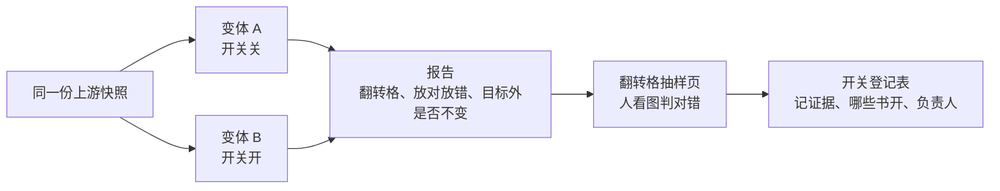

# 实验与评测

## A/B 实验（`guji pipeline exp`）

回答「这个开关开不开、对哪本书有效、会不会让别处变坏」：



```bash
guji pipeline exp run --base A.yaml --var B.yaml --books vol04,vol05 --from seed_admit --snapshot <快照> -w <工作区>
guji pipeline exp report <实验名> -w <工作区>
```

- 上游各步从快照硬链接，各变体只重跑 `--from` 之后的步；框架不动任何 Step 代码，不会让各书产物过期。
- 报告看三件事：目标对象变了多少、放对放错多少、目标以外的格是不是逐格不变。
- 会写库的实验上中心库**实验分支**，不碰正式数据。
- 结论写进 [doc/开关登记表.md](https://github.com/open-guji/open-guji-cv/blob/dev/doc/开关登记表.md)：每个「缺省关、按书开」的开关一行，有证据、有负责人。**开或关一个开关之前先有证据。**

框架细节：[doc/参考/exp_framework.md](https://github.com/open-guji/open-guji-cv/blob/dev/doc/参考/exp_framework.md)。

## 改切分：样页对比

改 版面、切字 的代码，在样页单（缺省实现 `impl/<版式>/samples.yaml`，或书仓 `code/samples.yaml`）上跑改前改后，变了的页逐页看图。见 [2d 字间切分](2-切字#怎么验)。

## 验收标准与 benchmark 登记（2026-11-28 起）

改一个小步合不合格，不看总分，看四件事：接口清楚、文档清楚、按书和册可控、可测试。仓里 [doc/验收标准.md](https://github.com/open-guji/open-guji-cv/blob/dev/doc/验收标准.md) 定了每个小步的 12 条（S1–S12）和每个大步的 6 条（B1–B6），各线合 PR 按它验收。其中跟评测有关的：

- **S11**：每个小步有一条「只跑本小步」的 benchmark：冻结上游输入，写明主指标和**必须为 0 的护栏**，按书报分，带翻转清单；脚本住在跟版本走的仓（cv `eval/` 或 manager 评测器）。
- **S12**：dataset 里有分片，金标挂在不随切分变的键上，随机页与难例分开，写明覆盖了哪几部书。
- **B4**：每个大步有一份按书的基线报告，注明 cv 提交和数据钉子。

每个小步的 bench、主指标、护栏、测试集、覆盖的书、基线报告登记在 [doc/bench登记表.md](https://github.com/open-guji/open-guji-cv/blob/dev/doc/bench登记表.md)，各线自己填。

各大步「必须为 0」的护栏：

| 大步 | 护栏 |
|---|---|
| 1 版面 | 正文页判成非正文；印章漏认压字 |
| 2 切字 | 好列被改坏；字身墨被切掉 |
| 3 识字 | 库外字误认成 same；形近字组内误判 |
| 4 定字 | 放错字 |

## 评测集（open-guji-dataset）

测试集在隔壁仓 [open-guji-dataset](https://github.com/open-guji/open-guji-dataset)，目录按功能模块命名；**按大步、小步找分片看它的 [STEP_MAP.md](https://github.com/open-guji/open-guji-dataset/blob/main/STEP_MAP.md)**（每个分片挂在哪个小步、多少条、覆盖哪几部书、哪些小步还没有分片）。主集举例：

| 小步 | 主集 | 跑法 |
|---|---|---|
| 1b | `layout`（79 页，四部书） | `python -m open_guji_cv.eval.layout_bench` |
| 2c | `char-segmentation/cut-frame` | cut-frame 打分脚本（ai-team，待搬） |
| 2d | `cut-lattice`（165 列，四部书） | `cut_bench.py`（ai-team，待搬） |
| 3a | `glyph-match/advset-*` | `guji pipeline eval run advset…` |
| 3c、4b | `char-candidates` | `guji pipeline eval run @cands` |
| 定字收尾 | `decide-bench` small／large | decide-bench `run.py`／`score.py`（ai-team，待搬） |

```bash
guji pipeline eval list                 # manager 评测器登记了哪些 bench、要不要语料或 GPU
guji pipeline eval run <bench id>
```

单元测试只用本仓冻结的小数据；对真书数据的质量断言归评测，不进测试。

## 重跑与跑批

整册重跑、AB、评测一律往**任务库**交单（`guji_jobs submit …`），由执行机领单跑完、存产物包。任务库命令与执行方在 guji-manager（`guji_manager/jobs/`，入口 `python -m guji_manager.jobs`），交单与看板的操作手册也在 guji-manager，设计见 [doc/design/重跑任务库.md](https://github.com/open-guji/open-guji-cv/blob/dev/doc/design/重跑任务库.md)。
