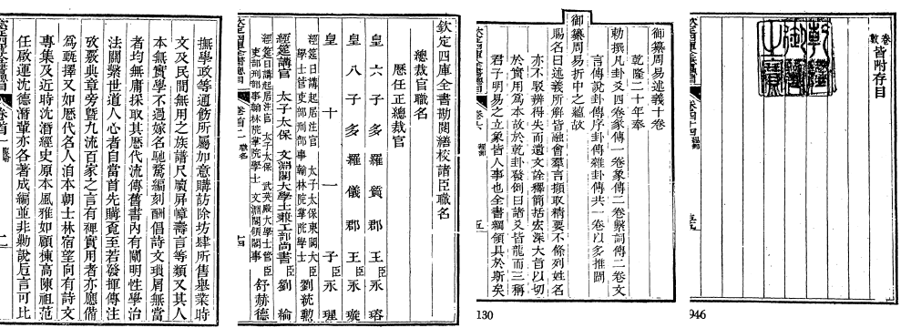
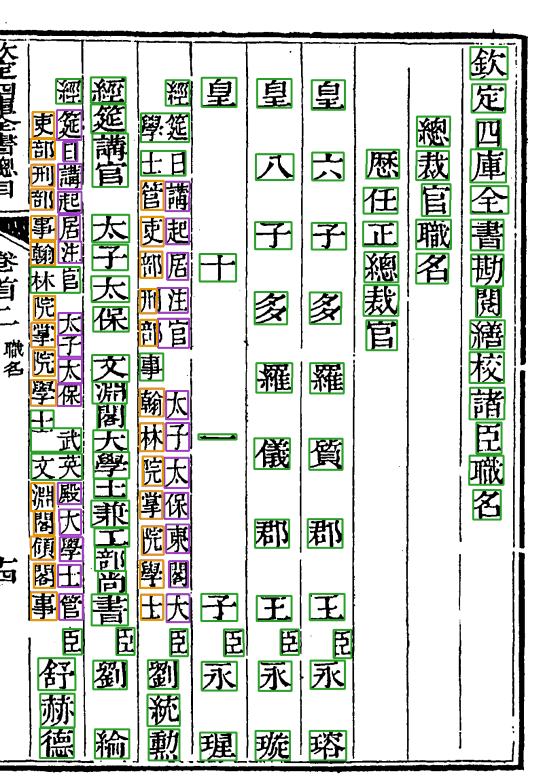
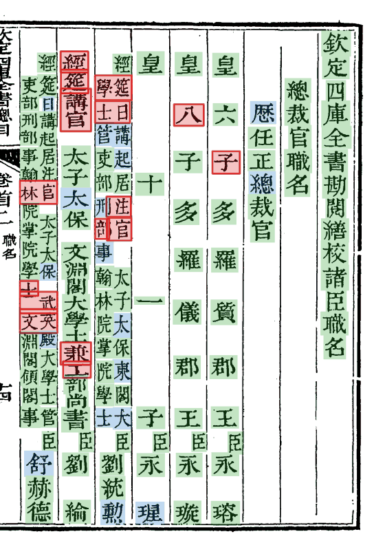
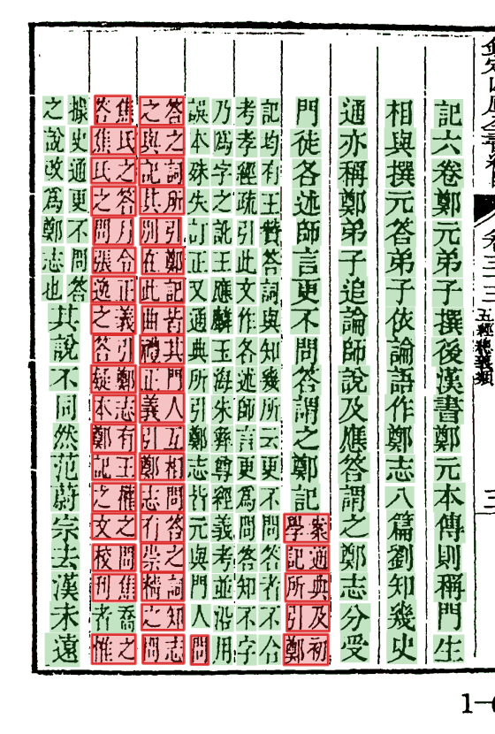

# 殿本四庫總目

《欽定四庫全書總目》武英殿刻本（book-index `96mid1ogzk`，套书 `siku_zongmu`）是本项目的主力书：99 册（200 卷＋卷首四卷），16,640 页。管线、闸、放行规则大多是在它身上一轮轮磨出来的，本 Wiki 各步的截图也多取自它。

*从左到右：vol01 第 3 页（卷首上谕）、vol01 第 87 页（职名）、vol04 第 9 页（正文提要，有抬头）、vol21 第 225 页（卷末，「乾隆御覽之寶」压着空栏）。*

## 版式

- 半叶九列，每列 21 格，四周双边，界行齐全（新图源上界行常常很淡）。
- **抬头**：「御纂」「欽定」「聖祖」等字顶格高出一截，版框在那一列凸出一个小框，见 [Step1](Step1-边框与界行#抬头框)。
- **夹注**：书名下「某某巡撫採進本」、提要里的小字，一格并排两行，读序先右后左，见 [Step3](Step3-逐字切分#夹注双行小字)。
- **大印、小印**：卷首、卷末各有收藏印、御览印，压在正文或空栏上，见 [印章](印章)。
- **职名页**（卷首）：官衔、人名字距不定，「臣」小字偏右，按整理本字数重切。

## 职名页

*vol01 第 87 页。左：字格。右：放行结果（绿底自动放行，蓝底人审定过，红框落人审）。职名里双行小字的官衔（「經筵日講官」「翰林院掌院學士」）最容易落审，这一页的红框几乎都在小字里。vol01 落审率 1.36%，明显高于正文册，主要就在这几十页。*

## 夹注页的放行

*vol16 第 6 页，右几列正文、左几列夹注，基本全部自动放行。*

## 各册现状（取图时各册的产物包）

| 册 | 页 | 格 | 落人审 | 落审率 | 包的 cv 版本 |
|---|---:|---:|---:|---:|---|
| vol01 | 204 | 24,397 | 332 | 1.36% | 0.5.27（冻结包） |
| vol04 | 218 | 34,471 | 80 | 0.23% | 0.5.26（main） |
| vol08 | 68 | 10,681 | 18 | 0.17% | 0.5.33 开发版 |
| vol16 | 180 | 29,266 | 108 | 0.37% | 0.5.33 开发版 |
| vol21 | 226 | 36,185 | 139 | 0.38% | 0.6.1 开发版 |
| vol40 | 174 | 25,776 | 60 | 0.23% | 0.6.1 开发版 |
| vol46 | 224 | 34,349 | 88 | 0.26% | 0.6.1 开发版 |
| vol84 | 144 | 22,597 | 62 | 0.27% | 0.6.1 开发版 |

正文册落审率在 0.2%–0.4% 之间；落审的格多半是切错的格、形近字、印下的字，见 [Step6–7 定字与放行](Step6-7-定字与放行#落人审的格长什么样)。全书各册的进度、版本以中心库台账和任务库为准，这张表只是写 Wiki 时取的样。

## 数据

- 原图：Wikimedia Commons 上的 DjVu 是唯一准确的根，登记成 R2 页表；2026-10 下旬整套换成重新切分的图源 `siku-qiefen-v2`（页号重编，改切分前先核样页单的页号）。
- 字形库：本书一个，按书 ID 收刻例（写 Wiki 时约 2.2 万例），按版本钉 `glyph_pin`。
- 整理本：文淵閣本系统的《總目》录文，按版本钉 `corpus: N`。
- 工作区仓：`guji-workspace/96mid1ogzk-si-ku-zong-mu`（只剩配置与说明，数据在中心库与 R2）。

样页单（改切分时必比的页，每页写着修过什么）：[books/siku_zongmu/samples.yaml](https://github.com/open-guji/open-guji-cv/blob/dev/open_guji_cv/books/siku_zongmu/samples.yaml)；书单：[doc/runbook/书单-四庫總目.md](https://github.com/open-guji/open-guji-cv/blob/dev/doc/runbook/书单-四庫總目.md)。
