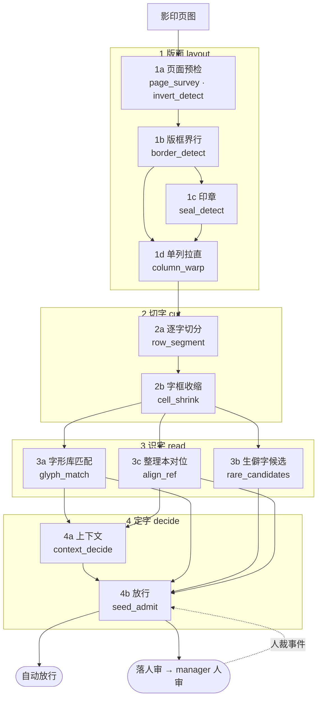

# 管线全景


*殿本 vol04 第 9 页右上角走过各步的样子。上排：原图 → 1b 版框与界行 → 1d 列带。下排：2a 字格 → 2b 紧框 → 4b 放行（绿底自动放行，蓝底人审定过）。*

## 四大步

cv 只管 guji-manager 五步里的第二步 `pipeline` 中「跑 CV 管线」这一块。管线本身分四大步（2026-11-22 起；原来的九步里，Step0–7 并成这四步，Step8 入库、Step9 排版输出移到了 manager）：

| 大步 | 命令里写 | 做什么 | 小步 |
|---|---|---|---|
| [1 版面](1-版面) | `layout` | 一页图 → 版框、界行、印章、拉直的一列一列 | 1a 页面预检 · 1b 版框界行 · 1c 印章 · 1d 单列拉直 |
| [2 切字](2-切字) | `cut` | 一列 → 一格一格，每格收成紧框 | 2a 逐字切分 · 2b 字框收缩 |
| [3 识字](3-识字) | `read` | 每格三路取证，互不投票 | 3a 字形库匹配 · 3b 生僻字候选 · 3c 整理本对位 |
| [4 定字](4-定字) | `decide` | 合起证据定字，决定自动放行还是落人审 | 4a 上下文 · 4b 放行 |



- **版面、切字**只看图，目标是每一格都切对。
- **识字**三路各自取证、互不投票（字形、生僻字、整理本文本）；**定字**里 4a 只在候选里按上下文重排，**只有 4b 决定放行还是落人审**。
- 人审、人裁事件入库、出逐字文本都在 guji-manager：入库归它的第二步 `pipeline`，排版输出归第五步 `output`（`guji output export`）。

跑法（`guji-cv` 是 cv 自己的命令行入口；guji-manager 里同一批命令写成 `guji pipeline …`，由 manager 转给 cv）：`guji-cv pipeline <管线> <册> -w <工作区> --from layout --to cut`，`--from`／`--to` 写大步名或步骤 id 都行；只跑一步 `guji-cv step <步骤 id> <册>`；看哪些过期 `guji-cv status <册>`。大步自己的工具命令带前缀，如 `guji-cv layout preclean`、`guji-cv read rare`。每步的输入输出、参数、闸的完整表在仓里 `doc/1-版面/` … `doc/4-定字/` 的「步骤与产物.md」（从代码生成）。

## 一条骨架，切分几步按版式换实现

每本书走的都是上面这一条骨架。不同的只有切分的 1b–2a。v0.7 起切分代码分三层：

- **共用原语** cv `seg/`：找线、拉直、投影、走缝……只看图，不认识任何一本书；
- **三条版式的缺省实现** cv `impl/keben|modern|free`：哪本书像哪条版式，就整套借用，不用写代码；
- **书级代码**（各书工作区仓的 `code/`）：只给这一本书用的切法，覆盖缺省实现里的同名模块，有自己的整数版本号 `k<N>`，不跟 cv 一起发版。书仓 `code/` 为空也能跑（全走缺省实现）。

| 版式（缺省实现） | 用在 | 1b–2a 怎么切 |
|---|---|---|
| `keben`（刻本，原 `siku_zongmu`） | 殿本四庫總目、北行日錄古本；史記、全唐文在它上面用书级代码改了几处 | 有版框、有界行、一列一列直排：版框界行 → 单列拉直 → 格网切字。本 Wiki 的大多数截图都是它 |
| `modern`（现代排印，原 `beixing`） | 近代排印本（北行日錄、考補萃編） | 没有界行，按墨柱找列、按墨段切字；横排先转 90° 再当竖排切 |
| `free`（自由版式，原 `zengguang_youxue`） | 增廣幼學須知鰲頭雜字 | 一页里上下分栏、大字夹小注、没有整齐的界行，先分块再找列；只在一册上试点，2b 以后还没接，见 [各书一览](各书一览#幼學鰲頭自由版式试点) |

有书级代码的书：史記文淵閣本（写本：职名页、雙行小注逐步切与两行字数可不等、大印下剔印泥）、全唐文（行切分分叉）。见 [各书一览](各书一览)。

- 1a（页面预检）和 2b–4b 各书用同一份代码；同一步的缺省参数写在缺省实现或书仓 `code/defaults.yaml`，个别书、个别册再在册配置里改。
- 只给一本书用的新行为不再往共用 Step 里加「缺省关、按书开」的开关，改写书级代码（2026-11-09 起的规矩）。共用 Step 留了几个**钩子**（缺省什么都不做，书仓覆盖就生效），如雙行小注 `jiazhu_step`、印泥 `seal_ink`。
- 共用的骨架写在一个文件里（`pipelines/_skeleton.yaml`）：1a、1b–2a 三个槽位、2b–4b，另有 `stages:` 把各步分进四大步。三个链 yaml（`keben_body_v2`、`modern_body`、`keben_free`）只写每个槽位里放哪几步，加载时按骨架展开；链由套书推出来，不用在册 yaml 里写。新增一个共用 Step 只改骨架一处。
- 一册书里的不同页型（正文、职名页、表格页、插图）不换管线，由各步按页型分开处理。

这样组织的来由和后面几步的计划，见 A20 的设计文档《三条管线对比与重组建议》（2026-11-03，方案 B）。

## 每步出口有一道闸

Step 跑完，挂在它身上的闸判断产物够不够格交给下一步（如 1b 的 `border_detect_gate` 判页型、列数；1d 的 `column_gate` 判每列切得开切不开）。闸不改产物，只决定「放过去、跳过、送人看」。

## 指纹与「过期」

每一步的产物都记一个**指纹**：这一步的代码（`code_hash`）、参数、上游产物的指纹、用到的字形库／语料版本。任何一项变了，这一步和它下游的产物就判**过期**，`guji-cv status` 会列出来，重跑只重算过期的部分。

- 改 Step 的代码会让所有册判过期，所以动之前要想清楚值不值；纯提速、产物逐字节不变的改动登记进 `core/code_equiv.py`，不让各书过期。
- 影响多数册的改动，PR 里要写清影响哪几步，并按「冻结基线与重跑分级」判 L0–L3；只重跑受影响的步、出差异单的做法见 [doc/参考/受控重跑.md](https://github.com/open-guji/open-guji-cv/blob/dev/doc/参考/受控重跑.md)。

## 代码在哪

```
open_guji_cv/
  steps/       各 Step 的壳（步骤 id、产物格式、指纹）
  seg/         切分共用原语：找线、拉直、投影、走缝……只看图，不认识任何一本书
  impl/<版式>/ 三条版式（keben／modern／free）的缺省切分实现＋样页单 samples.yaml
  book_api.py  书级代码能用的 cv 公开面（书仓 code/ 只许 import seg 和它）
  clustering/  字形匹配、放行判据（admission_decision）
  groups/      形近字组、异体
  pipelines/   各版式走哪几步的清单
  core/        Step 引擎、指纹、坐标、册配置
  products/    产物仓、图像缓存
```

包分层与依赖方向见 [doc/参考/module_map.md](https://github.com/open-guji/open-guji-cv/blob/dev/doc/参考/module_map.md)，切分的三层结构见 [doc/参考/切分代码结构.md](https://github.com/open-guji/open-guji-cv/blob/dev/doc/参考/切分代码结构.md)。
