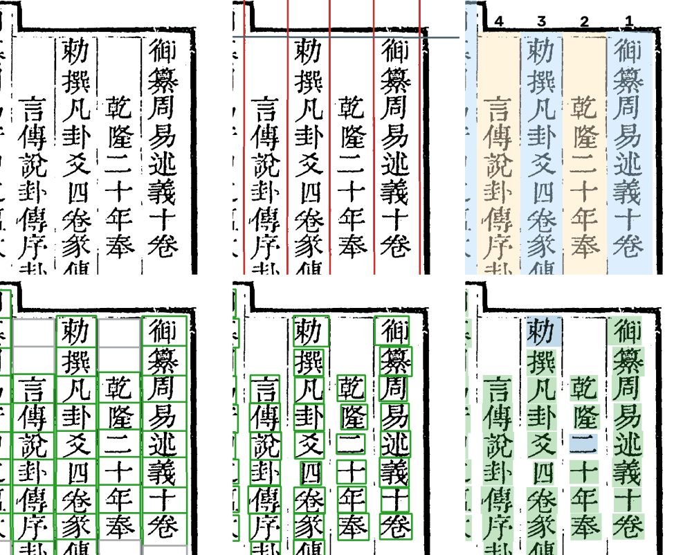
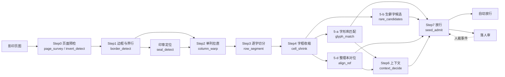

# 管线全景



*殿本 vol04 第 9 页右上角走过各步的样子。上排：原图 → Step1 版框与界行 → Step2 列带。下排：Step3 字格 → Step4 紧框 → Step7 放行（绿底自动放行，蓝底人审定过）。*

## 一张影印页要走哪几步



- **切分线 Step0–4**：只看图，目标是每一格都切对。
- **识别线 Step5–7**：Step5 三路各自取证、互不投票（字形、生僻字、整理本文本）；Step6 只在候选里按上下文重排；**只有 Step7 决定放行还是落人审**。
- 人审的结果记成事件，回流后让对应的格重算（Step8）；全部定完用 `guji export` 导出逐字转写（Step9）。

每一步的详细输入输出在仓里 [doc/design/流程与模块.md](https://github.com/open-guji/open-guji-cv/blob/dev/doc/design/流程与模块.md)、[doc/design/Step5-7-操作一览.md](https://github.com/open-guji/open-guji-cv/blob/dev/doc/design/Step5-7-操作一览.md)。

## 三条管线，按版面选

| 管线 | 用在 | 特点 |
|---|---|---|
| `keben_body_v2` | 刻本、写本正文（殿本四庫總目、史記文淵閣本、北行日錄古本） | 有版框、有界行、一列一列直排。本 Wiki 的大多数截图都是它 |
| `keben_free` | 自由版式（增廣幼學須知鰲頭雜字） | 一页里上下分栏、大字夹小注、没有整齐的界行，见 [自由版式](自由版式) |
| `modern_body` | 近代排印本 | 横竖混排、字距均匀，按行检测 |

管线就是一个 yaml（`open_guji_cv/pipelines/*.yaml`），列出这条管线用哪几个 Step；Step 之间按「谁产出什么、谁消费什么」连成一张有向图。新版面＝新 yaml＋缺的那几个 Step。

## 每步出口有一道闸

Step 跑完，挂在它身上的闸判断产物够不够格交给下一步（如 Step1 的 `border_detect_gate` 判页型、列数；Step2 的 `column_gate` 判每列切得开切不开）。闸不改产物，只决定「放过去、跳过、送人看」。

## 指纹与「过期」

每一步的产物都记一个**指纹**：这一步的代码（`code_hash`）、参数、上游产物的指纹、用到的字形库／语料版本。任何一项变了，这一步和它下游的产物就判**过期**，`guji status` 会列出来，重跑只重算过期的部分。

- 改 Step 的代码会让所有册判过期，所以动之前要想清楚值不值；纯提速、产物逐字节不变的改动登记进 `core/code_equiv.py`，不让各书过期。
- 影响多数册的改动，PR 里要写清影响哪几步，并按「冻结基线与重跑分级」判 L0–L3；只重跑受影响的步、出差异单的做法见 [doc/受控重跑.md](https://github.com/open-guji/open-guji-cv/blob/dev/doc/受控重跑.md)。

## Step0 页面预检（没有截图的一步）

- `page_survey`：量每页原图尺寸，和本册中位数比，标出异常页（对开没拆、裁掉半页、扫进了别的东西）。
- `invert_detect`：找界行被扫成白底黑带的「反色带」，只送人看，不自动修；人点头后进预清理（`guji preclean`），管线后面各步读预清理过的图。

殿本这几册都没有命中，所以这里没有放图。

## 代码在哪

```
open_guji_cv/
  steps/       各 Step 的壳（步骤 id、产物格式、指纹）
  seg/         切分共用原语：找线、拉直、投影、走缝……只看图，不认识任何一套书
  books/<套书>/ 每套书自己的切分代码＋样页单 samples.yaml
  clustering/  字形匹配、放行判据（admission_decision）
  groups/      形近字组、异体
  pipelines/   三条管线的 yaml
  core/        Step 引擎、指纹、坐标、册配置
  products/    产物仓、图像缓存
```

包分层与依赖方向见 [doc/module_map.md](https://github.com/open-guji/open-guji-cv/blob/dev/doc/module_map.md)，切分的两层结构见 [doc/切分代码结构.md](https://github.com/open-guji/open-guji-cv/blob/dev/doc/切分代码结构.md)。
