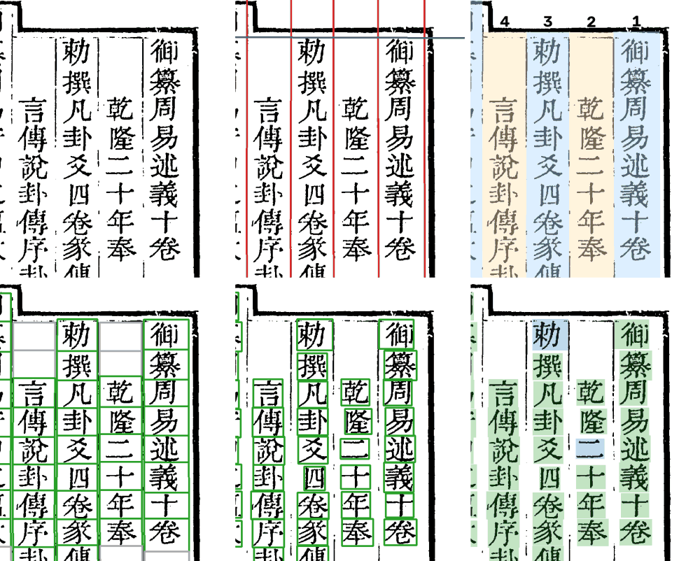
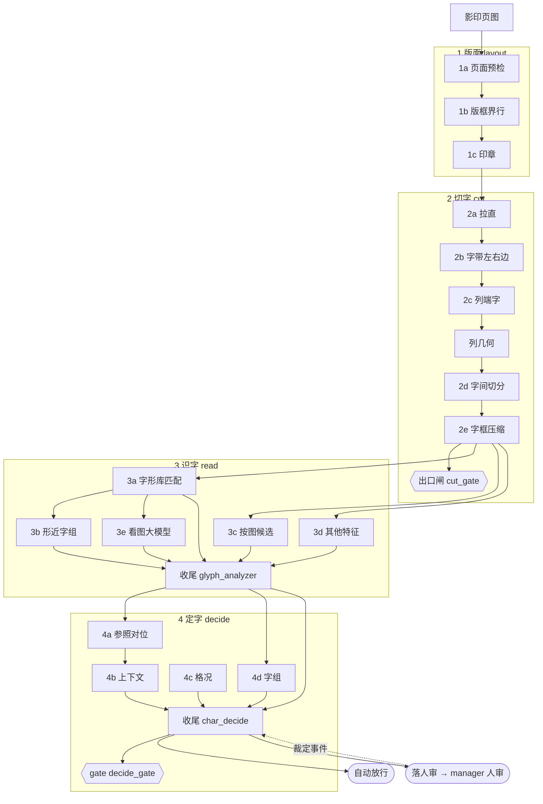

# 管线全景



*殿本 vol04 第 9 页右上角走过各步的样子。上排：原图 → 1b 版框与界行 → 2a 拉直后的列带。下排：2d 字格 → 2e 紧框 → 定字收尾的放行结果（绿底自动放行，蓝底人审定过）。*

## 四大步与小步

cv 只管 guji-manager 五步里的第二步 `pipeline` 中「跑 CV 管线」这一块。管线本身分四大步（2026-11-22 起；原来的九步里，Step0–7 并成这四步，Step8 入库、Step9 排版输出移到了 manager）。每个大步下面再分小步，**每个小步是一个独立的 Step**（2026-11-25 至 11-28 陆续拆开），可以单独跑、单独量、按书按册开关。

| 大步 | 命令里写 | 做什么 | 小步（Step id） |
|---|---|---|---|
| [1 版面](1-版面) | `layout` | 一页图 → 版框、界行、页型、印章的位置和类型 | 1a 页面预检 `page_survey`、`invert_detect` · 1b 版框界行 `border_detect` · 1c 印章 `seal_detect` |
| [2 切字](2-切字) | `cut` | 一列 → 拉直、去线、切成一格一格、每格收成紧框 | 2a 拉直 `column_warp` · 2b 字带左右边 `column_band` · 2c 列端字 `column_end` · 列几何 `column_geometry` · 2d 字间切分 `row_segment` · 2e 字框压缩 `cell_shrink` · 出口闸 `cut_gate` |
| [3 识字](3-识字) | `read` | 每格只从字块图取证，各路互不投票 | 3a 字形库匹配 `glyph_match` · 3b 形近字组 `glyph_near` · 3c 按图候选 `glyph_candidate` · 3d 其他特征 `cell_traits` · 3e 看图大模型 `glyph_vis` · 收尾 `glyph_analyzer` |
| [4 定字](4-定字) | `decide` | 对上参校本、合起证据定字，决定自动放行还是落人审 | 4a 参照对位 `align_ref` · 4b 上下文 `context_decide`、`context_rank` · 4c 格况 `cell_state` · 4d 字组 `group_decision` · 收尾 `char_decide` · gate `decide_gate` |

小步表以代码为准：骨架 `pipelines/_skeleton.yaml` 的 `stages:` 把每个步骤 id 分进一个大步，仓里各大步的 README 必须列全这些 id（`tests/test_stage_docs.py` 守着）。每步的输入输出、参数、闸的完整表在 `doc/1-版面/` … `doc/4-定字/` 的「步骤与产物.md」（从代码生成）。



三条纪律贯穿各大步（2026-11-26 至 11-28 用户定）：

- **小步只出证据**：不定字、不判放行、不改上游产物。版面、切字只看图；识字只看字块图，3a–3e 互不投票。
- **收尾是大步唯一的出口**：识字收尾 `glyph_analyzer` 把 3a–3e 汇成每格一条候选（字＋概率＋证据），第四步只读它；定字收尾 `char_decide`（旧名 `seed_admit`）做全部判断：人裁覆盖、定字、放行通道、否决、送审原因。
- **闸／gate 只检测**：`cut_gate`、`decide_gate` 读整个大步的产物，出检测清单，不改任何格、不挡中间步、不进别的步骤的指纹。

人审、裁定事件入库、出逐字文本都在 guji-manager：入库归它的第二步 `pipeline`，排版输出归第五步 `output`（`guji output export`）。

## 怎么跑

`guji-cv` 是 cv 自己的命令行入口；guji-manager 里同一批命令写成 `guji pipeline …`，由 manager 转给 cv。

```bash
guji-cv pipeline guji_default <册> -w <工作区>                        # 四大步全跑
guji-cv pipeline guji_default <册> --from cut --to cut -w <工作区>     # 只跑一个大步（--from/--to 写大步名或步骤 id）
guji-cv step column_end <册> -w <工作区>                          # 只跑一个小步
guji-cv status <册> -w <工作区>                                   # 哪些步过期
```

大步自己的工具命令带前缀，如 `guji-cv layout preclean`、`guji-cv read rare`、`guji-cv decide variants`。

## 新小步缺省关，按书按册打开

11-25 以后新拆出来的小步，凡是会改产物的都**缺省关**：`params.<步骤 id>.enabled: true` 写在书的基础配置（中心库 `config/book_defaults.yaml`）或某册的 `books/<册>.yaml` 里才跑。关着时下游照旧现算，产物逐字节不变，不用重跑。

| 小步 | 缺省 | 关着时 |
|---|---|---|
| 2a–2e、列几何、`cut_gate` | 开（刻本链） | — |
| 3b `glyph_near` | 关（书配置 `groups` 空＝不跑） | 第四步本地现算看图判法 |
| 3c `glyph_candidate`、3d `cell_traits`、3e `glyph_vis`、识字收尾 `glyph_analyzer` | 关 | 第四步读 3a 和旧生僻字候选 |
| 4b `context_rank` | 关 | 只有 `context_decide` 的门槛首选 |
| 4c `cell_state`、4d `group_decision` | 关 | 收尾现算，产物逐字节不变 |
| `decide_gate` | 开（只出检测产物） | — |

只给一本书用的切法不进 cv 开关，进这本书自己的书仓 `code/`（见下一节）。配置分几层（全局、组、书、册、页、本次运行）、每个键该写在哪一层，以仓里配置说明为准。

## 一条骨架，切分几步按版式换实现

每本书走的都是上面这一条骨架，不同的只有切分的 1b 与 2a–2d。切分代码分三层：

- **共用原语** cv `seg/`：找线、拉直、投影、走缝……只看图，不认识任何一本书；
- **版式的缺省实现** cv `impl/keben|modern|free`：哪本书像哪条版式，就整套借用，不用写代码；
- **书级代码**（各书工作区仓的 `code/`）：只给这一本书用的切法，覆盖缺省实现里的同名模块，有自己的整数版本号 `k<N>`，不跟 cv 一起发版。书仓 `code/` 为空也能跑。

全项目只有一条默认链 `guji_default`（2026-11-28 用户定，刻本写本、坊刻、现代排印都走它），书与书的差别只是**版式**：


| 版式 `layout`（缺省实现，旧链名） | 用在 | 1b–2d 怎么切 |
|---|---|---|
| `grid`（`impl/keben`，旧 `keben_body_v2`） | 殿本四庫總目、史記、全唐文、脉经、北行古本等 | 有版框、有界行、一列一列直排：版框界行 → 拉直 → 抹界行 → 剥列端框 → 格网切字。本 Wiki 的大多数截图都是它 |
| `print`（`impl/modern`，旧 `modern_body`） | 近代排印本 | 没有界行，按墨柱找列（`line_detect`、`column_crop`）、按墨段切字（`row_segment_runs`）；横排先转 90° |
| `free`（`impl/free`，旧 `keben_free`） | 幼學鰲頭试点 | 上下分栏、大字夹小注、没有整齐界行：先分块（`block_detect`），块里找列（`column_trace`）、切字（`cell_cut`） |

> 旧链名照认：`guji-cv pipeline keben_body_v2 …` 等于 `guji_default@grid`。版式不用写，按套书、书仓 `base:`、`edition` 推出来，缺省 grid；要改在书配置写 `layout:`。只换「怎么选」，步骤 id、产物、指纹都没变。自由版式接上 2e 以后各步是下一期（CV2）。

- 共用的骨架写在 `pipelines/_skeleton.yaml`：1a、1b–2d 的几个槽位、2e–4 的共用步骤，`stages:` 把各步分进四大步，`finals:` 登记收尾。默认链 `pipelines/guji_default.yaml` 的 `layouts:` 下每个版式只写槽位放哪几步，加载时按册的版式、再按骨架展开。新增一个共用 Step 只改骨架一处。
- 一册书里的不同页型（正文、职名页、表格页、插图）不换管线，由各步按页型分开处理，见 [页型、表格页与插图](页型表格页与插图)。

## 每个大步出口有一道闸

| 闸 | 挂在 | 看什么 |
|---|---|---|
| `border_detect_gate` | 1b | 页型、列数、界行跑飞、外框缺失；封面、书签、表格页跳过 |
| `cut_gate` | 2e（刻本链；现代链是 `column_gate`） | 列数、列宽、界行残墨、印章噪点、框线残留……只出裁决 |
| `decide_gate` | 定字收尾 | 放行字在不在证据里、参校本错位、放行格其实是空白……出 `fail`／`flag` 清单 |

闸不改产物，只给出「放过去、跳过、送人看」的判断和检测清单。

## 指纹与「过期」

每一步的产物都记一个**指纹**：这一步的代码（`code_hash`）、生效参数、上游产物的指纹、用到的字形库／语料／模型版本。任何一项变了，这一步和它下游的产物就判**过期**，`guji-cv status` 会列出来，重跑只重算过期的部分。

- 改 Step 的代码会让所有册判过期，所以动之前要想清楚值不值；纯搬家、产物逐字节不变的改动登记进 `core/code_equiv.py`，不让各书过期（小步拆分都是这样做的）。
- 影响多数册的改动，PR 里要写清影响哪几步，并按「冻结基线与重跑分级」判 L0–L3。出过 v0.1 的册不重跑，直接改待审单。

## 怎么验收一个小步

仓里 [doc/验收标准.md](https://github.com/open-guji/open-guji-cv/blob/dev/doc/验收标准.md) 定了每个小步的 12 条（接口、文档、可控、可测试）和每个大步的 6 条；每个小步跑哪个 benchmark、主指标、护栏，登记在 [doc/bench登记表.md](https://github.com/open-guji/open-guji-cv/blob/dev/doc/bench登记表.md)。测试集按小步的索引在 open-guji-dataset 的 [STEP_MAP.md](https://github.com/open-guji/open-guji-dataset/blob/main/STEP_MAP.md)。见 [实验与评测](实验与评测)。

## 代码在哪

```
open_guji_cv/
  steps/       各 Step 的壳（步骤 id、产物格式、指纹），一个小步一个模块
  seg/         切分共用原语：找线、拉直、投影、走缝、侧切点……只看图，不认识任何一本书
  impl/<版式>/ 三条版式（keben／modern／free）的缺省切分实现＋样页单 samples.yaml
  book_api.py  书级代码能用的 cv 公开面（书仓 code/ 只许 import seg 和它）
  clustering/  字形匹配、上下文、放行判据
  groups/      形近字组、异体；3b 的看图方法在 groups/near_methods/
  gates/       出口闸
  pipelines/   骨架与各链的步骤清单
  core/        Step 引擎、指纹、坐标、册配置
  products/    产物格式（kinds/）、产物仓、图像缓存
```

包分层与依赖方向见 [doc/参考/module_map.md](https://github.com/open-guji/open-guji-cv/blob/dev/doc/参考/module_map.md)，切分的三层结构见 [doc/参考/切分代码结构.md](https://github.com/open-guji/open-guji-cv/blob/dev/doc/参考/切分代码结构.md)。
