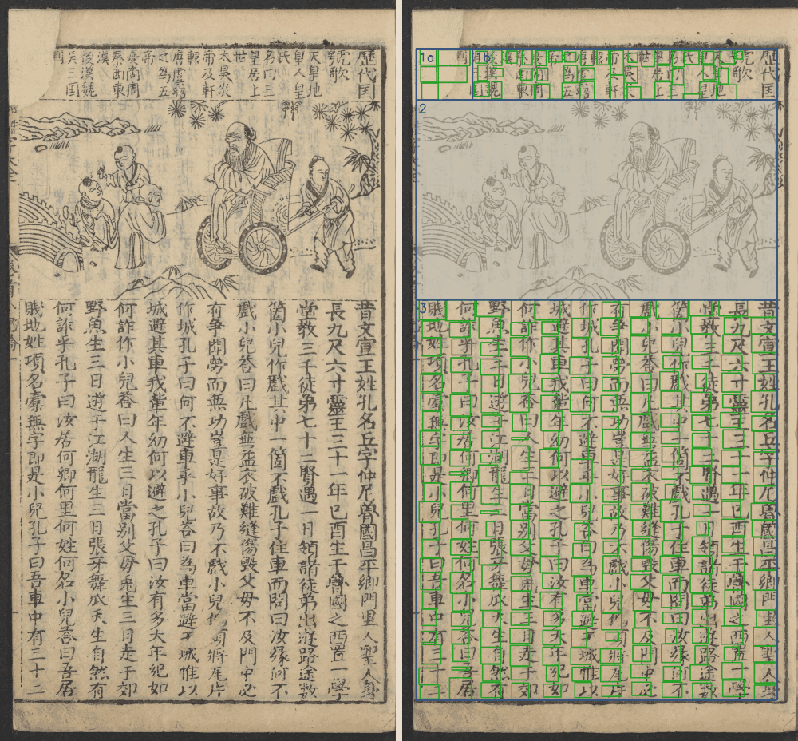
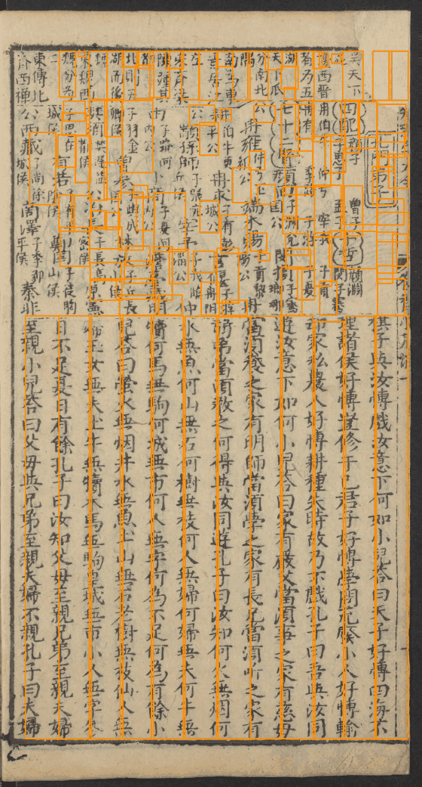
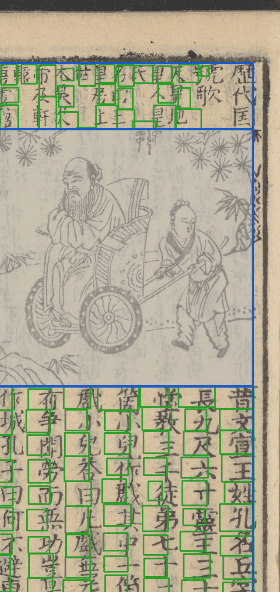

# 自由版式（管线 `keben_free`）

*《增廣幼學須知鰲頭雜字大全》（康熙十七年文萃堂刻本，册 `yxat`）第 9 页。左：原图。右：按框线拉正后，分成 1a、1b（上栏两块）、2（插图，灰底，跳过）、3（下栏正文）四块，绿框是切出的字。*

## 为什么另起一条管线

殿本那条链（`keben_body_v2`）靠三个前提：每列固定格数、靠界行定列、一页一块版面。坊刻本三条都不成立：同一列里大字、双行小注交替；大多没有界行；一页上下分栏，还夹着插图；扫描是灰度彩图。所以切分三步重写，产物也另立种类。

**原则（Sheldon 10-27 定）**：做通用的大框架，不追求特殊版面全自动。个别页由人先标「这页什么版面、分几块、每块几列、什么格式」（`layout_hints`），算法照着做。

## 四步

| 步 | 产物 | 做什么 |
|---|---|---|
| `block_detect` | `layout_blocks` | 找外框、分栏线，**按框线把整页拉正**（倾斜、透视、弯框），分成块；块有编号（1a、1b、2…）和格式 `fmt` |
| `column_trace` | `free_columns` | 每块里找列：有人标列距就等宽网格，没有就自估 |
| `line_ocr` | `free_ocr_lines` | 可选：逐列送 PaddleOCR 读出文字行，给下一步当先验 |
| `cell_cut` | `free_cells` | 列内切字：分「大字／双行小注／单行小注」区，按识别出的字数切；`fmt: plain` 的块整列按墨切 |

识别软件读出的文字行（橙框）：

下栏正文切字放大看（第 9 页右上）：

## 现状（v0.6）

只有 `yxat` 一册在用，Sheldon 盯着第 9、10 页逐轮调（到第八轮）。上栏杂字块、小注切得还不齐，看图可见不少字框偏了半格，**还不能整册跑批**。这一页的图是在云端会话里本地跑的（R2 里还没有这册的产物包；PaddleOCR 在这台机器上要关掉 mkldnn 才跑得动）。

设计与各轮实测：[doc/design/自由版式切分-游学鳌头.md](https://github.com/open-guji/open-guji-cv/blob/dev/doc/design/自由版式切分-游学鳌头.md)。
