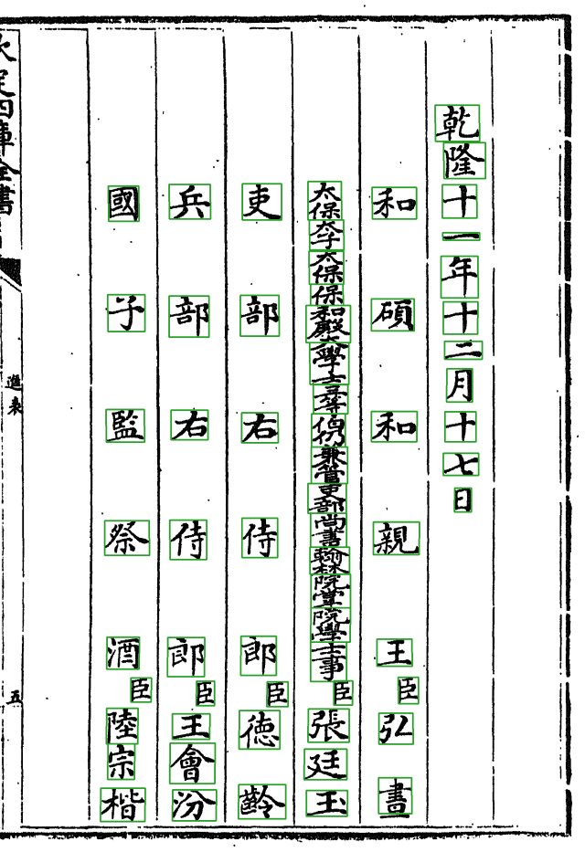
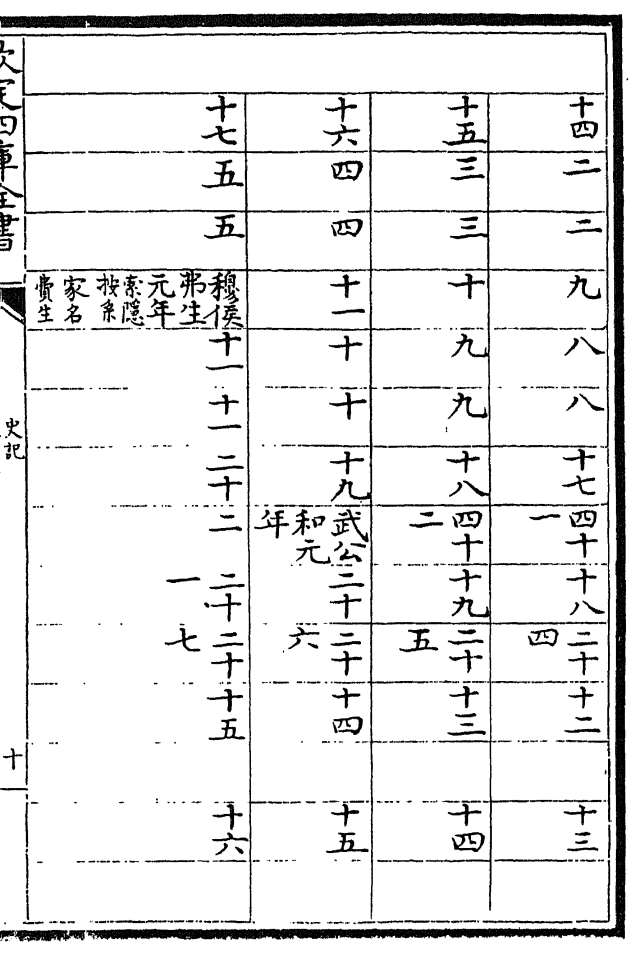

# 页型、表格页与插图

## 页型

Step1 的出口闸给每页定一个页型，决定这页后面怎么走：

| 页型 | 例子 | 后面 |
|---|---|---|
| `body` 正文、`roster` 职名、`toc` 目录 | 绝大多数页 | 标准网格，照常切分识别 |
| `blank` 空栏页 | 界行齐全但没有字的叶 | 照常切，产出空页（界行是齐的，切了也不会错） |
| `edict` 上谕 | 卷首上谕 | 自定的切法 |
| `cover`、`label`、`colophon` | 封面、书签、牌记 | 跳过 |
| `table` 表格页 | 史記年表 | 跳过（只由册配置点名，见下） |

页型由规则判（`clustering/page_type.py`），第一刀是「有没有界行栏格」。

职名页（一列一个官衔、人名下小字「臣」）也走正文管线，但由套书自己的 `roster_segment` 按整理本字数切。

*史記文淵閣本 01 册第 40 页，职名页：官衔大字、「臣」小字偏右、人名两三字，字距完全不规则。*

## 表格页

*史記 09 册第 20 页，年表。横竖都有线，一格里一两个字或一段小字，按列切会把横线当字。*

年表暂时搁置（Sheldon 11-02 定）：册配置 `border_detect_gate.table_pages` 点名的页记页型 `table`，整页跳过，不切分、不出待审、不进统计。缺省为空，各书产物不变。以后怎么做见 ai-team `domain/CV/新书登记/史记文渊阁/年表方案.md`。

## 插图与图片格

- **整块插图**：自由版式里由人标成 `skip` 块（见 [自由版式](自由版式) 第 9 页的块 2）。
- **字位上的图形**（圈、符号、小图）：人审时裁成 `figure`（带一句 `alt` 说明），这格进排除名单，不进字形库、不出卡，转写里占位 □；导出时按框从页图裁出图片，写进 `NNN.fig.json`。

流程：[doc/design/图片格与插图-处理流程.md](https://github.com/open-guji/open-guji-cv/blob/dev/doc/design/图片格与插图-处理流程.md)。
